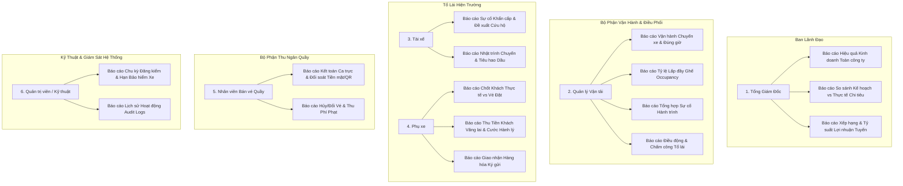

# ĐỀ XUẤT HỆ THỐNG BÁO CÁO CHO TỪNG BỘ PHẬN (CÁC ACTOR)
> **Dự án**: Hệ Thống Quản Lý Nhà Xe Thông Minh (KLTN)  
> **Phạm vi**: Thiết kế hệ thống báo cáo chuyên biệt cho các bộ phận, **loại trừ Quản lý nhà xe (`fleet_manager`)**  
> **Mục tiêu**: Xác định rõ từng Actor cần lập báo cáo gì, xem báo cáo gì, dữ liệu đầu vào/ra và giá trị thực tế mang lại.

---

## TỔNG HỢP CÁC BỘ PHẬN & BÁO CÁO CẦN XÂY DỰNG

---

## 1. TỔNG GIÁM ĐỐC (`general_manager`)
*Vai trò: Định hướng chiến lược, kiểm soát tài chính tổng thể và phê duyệt báo cáo cấp cao.*

### Báo cáo 1.1: Báo cáo Tổng hợp Hiệu quả Kinh doanh Toàn công ty (Executive Business Report)
* **Mục đích**: Ban Giám Đốc nắm bắt tức thời sức khỏe tài chính toàn bộ hệ thống.
* **Nội dung hiển thị**:
  * Tổng doanh thu toàn công ty (so sánh theo tuần, tháng, quý, năm).
  * So sánh doanh thu và tỷ suất đóng góp giữa các Chi nhánh/Nhà xe.
  * Cơ cấu doanh thu theo nguồn: Đặt online, Vé quầy, Cước hàng hóa (`Shipment`), Thu dọc đường.
  * Tỷ lệ tăng trưởng so với cùng kỳ tháng/năm trước.
* **Dữ liệu đầu ra**: Biểu đồ cột so sánh chi nhánh, biểu đồ tròn cơ cấu nguồn thu, file PDF/Excel tóm lược.

### Báo cáo 1.2: Báo cáo Đối soát Ngân sách Kế hoạch vs Thực tế (Budget vs Actual Report)
* **Mục đích**: Kiểm soát việc chi tiêu không bị vượt hạn mức đã duyệt đầu tháng.
* **Nội dung hiển thị**:
  * Chỉ tiêu ngân sách từng mục (`OperationalTarget`): Nhiên liệu, Bảo dưỡng xe, Quỹ lương, Phí bến bãi, Marketing.
  * Số tiền thực chi lũy kế đến ngày hiện tại.
  * Cảnh báo chênh lệch (% bội chi hoặc tiết kiệm ngân sách).

### Báo cáo 1.3: Báo cáo Đánh giá Hiệu quả Tuyến xe (Route Profitability Report)
* **Mục đích**: Nhận diện các tuyến xe mang lại doanh thu cao nhất (Top Performing Routes) và các tuyến xe vắng khách cần cắt giảm tần suất hoặc hạ giá vé kích cầu.
* **Nội dung hiển thị**: Tuyến xe, số chuyến đã khai thác, doanh thu bình quân/chuyến, tỷ lệ lấp đầy bình quân.

---

## 2. QUẢN LÝ VẬN TẢI / ĐIỀU PHỐI VẬN HÀNH (`ops_manager`)
*Vai trò: Điều phối lịch xe, xếp tài xế/phụ xe, giám sát an toàn hành trình và theo dõi báo cáo vận tải trực tiếp bằng bộ lọc thời gian thực.*

### Báo cáo 2.1: Báo cáo Vận hành Chuyến xe & Tỷ lệ Đúng giờ (Trip Punctuality & Dispatch Report)
* **Mục đích**: Đánh giá độ tin cậy và kỷ luật xuất/cập bến của các chuyến xe.
* **Nội dung hiển thị**:
  * Tổng số chuyến lên kế hoạch, số chuyến chạy thực tế, số chuyến hủy.
  * Tỷ lệ đúng giờ (On-time Departure & Arrival Rate).
  * Danh sách chuyến trễ giờ kèm ghi chú nguyên nhân (kẹt xe, chờ khách, thời tiết).

### Báo cáo 2.2: Báo cáo Tỷ lệ Lấp đầy Ghế (Seat Occupancy Report)
* **Mục đích**: Giám sát hiệu suất sử dụng tải của phương tiện theo ngày/khung giờ.
* **Nội dung hiển thị**:
  * Tỷ lệ lấp đầy bình quân (%) trên từng tuyến và loại xe (Limousine, Giường nằm, Ghế ngồi).
  * Biểu đồ nhiệt (Heatmap) thể hiện khung giờ đông khách nhất trong ngày (sáng sớm, tối đêm).

### Báo cáo 2.3: Báo cáo Tổng hợp Sự cố Hành trình (Incident Summary Report)
* **Mục đích**: Báo cáo phục vụ họp an toàn giao thông và đánh giá chất lượng kỹ thuật phương tiện.
* **Nội dung hiển thị**:
  * Tổng số vụ sự cố trong tuần/tháng.
  * Phân loại: Sự cố kỹ thuật (nổ lốp, hỏng điều hòa, sự cố máy), va quẹt giao thông, sự cố hành khách.
  * Thời gian xử lý trung bình và chi phí thiệt hại (nếu có).

### Báo cáo 2.4: Báo cáo Điều động & Chấm công Tổ lái (Crew Timesheet & Workload Report)
* **Mục đích**: Đảm bảo tuân thủ luật lao động, an toàn lái xe (không lái quá 4 tiếng liên tục / 10 tiếng/ngày) và tính công lương.
* **Nội dung hiển thị**:
  * Tổng số giờ lái xe của từng tài xế trong tháng.
  * Số chuyến phụ xe đã hỗ trợ.
  * Tỷ lệ vắng mặt, số ngày nghỉ phép có duyệt (`LeaveRequest`).

---

## 3. TÀI XẾ (`driver`)
*Vai trò: Trực tiếp điều khiển phương tiện, chịu trách nhiệm về an toàn kỹ thuật và lộ trình.*

### Báo cáo 3.1: Báo cáo Sự cố Khẩn cấp & Đề xuất Xử lý (Emergency Incident Report)
* **Thời điểm tạo**: Ngay khi phát sinh sự cố trên đường.
* **Nội dung tài xế báo cáo**:
  * Vị trí xảy ra sự cố (định vị GPS tự động hoặc cột mốc km trên quốc lộ).
  * Loại sự cố: Hỏng máy, thủng lốp, va chạm, đường sạt lở/ngập lụt, khách có vấn đề sức khỏe.
  * Mức độ nghiêm trọng: Nghiêm trọng (không thể di chuyển), Vừa (cần sửa tại chỗ), Nhẹ (vẫn tiếp tục được).
  * Ảnh chụp hiện trường.
  * **Đề xuất của tài xế**: Đề xuất điều xe trung chuyển rước khách, gọi xe cẩu cứu hộ, hoặc cần thợ lưu động.

### Báo cáo 3.2: Báo cáo Nhật trình Chuyến xe (Trip Daily Log)
* **Thời điểm tạo**: Kết thúc chuyến xe.
* **Nội dung tài xế báo cáo**:
  * Số km khởi hành (Odo đi) và số km về bến (Odo đến).
  * Lượng dầu đổ thêm dọc đường (số lít, số tiền, ảnh chụp phiếu đổ xăng dầu).
  * Tình trạng bất thường của xe cần lưu ý cho ca tiếp theo.

### Báo cáo 3.3: Bảng Tổng kết Cá nhân của Tài xế (Driver Personal Summary)
* **Tài xế xem**:
  * Số chuyến đã hoàn thành trong tháng.
  * Số giờ cầm lái tích lũy.
  * Điểm đánh giá trung bình từ hành khách (sao rating & nhận xét thái độ phục vụ/lái xe êm ái).

---

## 4. PHỤ XE / TIẾP VIÊN XE (`attendant`)
*Vai trò: Phục vụ khách trên xe, kiểm đếm hành khách, giữ trật tự và quản lý hành lý ký gửi.*

### Báo cáo 4.1: Báo cáo Chốt Khách Thực Tế vs Danh Sách Vé (Passenger Reconciliation Report)
* **Thời điểm tạo**: Sau khi hoàn thành đón khách tại các trạm/bến.
* **Nội dung phụ xe báo cáo**:
  * Tổng số khách đặt trên vé (`bookedCount`).
  * Số khách thực tế có mặt trên xe (`actualCount`).
  * Số khách không đến / hủy sát giờ (`noShowCount`).
  * Danh sách ghế trống thực tế sau khi xuất phát.

### Báo cáo 4.2: Báo cáo Thu Tiền Khách Vãng Lai & Phụ Phí (On-board Cash Collection Report)
* **Thời điểm tạo**: Kết thúc chuyến xe.
* **Nội dung phụ xe báo cáo**:
  * Số khách vãng lai đón dọc đường không đặt trước qua web/quầy.
  * Tổng số tiền mặt đã thu từ khách vãng lai.
  * Tiền phụ thu hành lý quá khổ/xe máy chở kèm khoang gầm.
  * Bàn giao tiền mặt về thủ quỹ chi nhánh khi xe về bến.

### Báo cáo 4.3: Báo cáo Giao nhận Hàng hóa Ký gửi (Cargo Delivery Log)
* **Thời điểm tạo**: Trong suốt hành trình đón - trả hàng.
* **Nội dung phụ xe báo cáo**:
  * Mã kiện hàng ký gửi (`Shipment`).
  * Điểm trả hàng và người nhận đã ký nhận.
  * Ghi nhận sự cố hư hỏng, thất lạc kiện hàng (nếu có).

---

## 5. NHÂN VIÊN BÁN VÉ QUẦY (`ticket_agent`)
*Vai trò: Bán vé trực tiếp, in vé, thu tiền mặt/chuyển khoản và giải quyết khiếu nại tại phòng vé bến xe.*

### Báo cáo 5.1: Báo cáo Kết toán Ca trực (Shift Handover & Cash Reconciliation Report)
* **Thời điểm tạo**: Khi kết thúc ca làm việc (giao ca).
* **Nội dung nhân viên báo cáo**:
  * Tiền mặt bàn giao đầu ca (tiền lẻ thối).
  * Tổng số vé bán ra trong ca.
  * Doanh thu tiền mặt thực tế thu được trong ca.
  * Doanh thu thanh toán không tiền mặt (chuyển khoản quét QR / quẹt thẻ POS).
  * Số tiền mặt thực tế đóng vào két và giao cho ca sau.
  * Chênh lệch quỹ: Khớp / Thừa / Thiếu (kèm lý do giải trình).

### Báo cáo 5.2: Báo cáo Hủy / Đổi Vé & Phí Phạt (Ticket Refund & Penalty Report)
* **Thời điểm tạo**: Theo ca hoặc theo ngày.
* **Nội dung nhân viên báo cáo**:
  * Danh sách vé khách đến quầy xin hủy hoặc đổi giờ chạy.
  * Số tiền đã hoàn lại cho khách.
  * Số tiền phí phạt hủy vé thu được theo quy định của nhà xe.

---

## 6. QUẢN TRỊ VIÊN HỆ THỐNG / KỸ THUẬT CNTT (`admin`)
*Vai trò: Đảm bảo hạ tầng hoạt động thông suốt, an toàn dữ liệu và tuân thủ quy định.*

### Báo cáo 6.1: Báo cáo Chu kỳ Đăng kiểm & Bảo hiểm Phương tiện (Inspection & Insurance Expiry Report)
* **Nội dung hiển thị**:
  * Danh sách phương tiện sắp hết hạn đăng kiểm trong vòng 15 - 30 ngày.
  * Danh sách xe sắp hết hạn bảo hiểm trách nhiệm dân sự.
  * Cảnh báo xe đến hạn bảo dưỡng lớn (cấp 20.000km, 50.000km, 100.000km).

### Báo cáo 6.2: Báo cáo Nhật ký Hoạt động Hệ thống (System Audit & Security Log)
* **Nội dung hiển thị**:
  * Thống kê các thao tác nhạy cảm: Điều chỉnh giá vé, xóa chuyến, duyệt chi tiêu lớn, hủy vé hoàn tiền.
  * Tần suất truy cập, lượt đăng nhập lỗi, thời gian phản hồi API.

---

## MA TRẬN TỔNG HỢP THEO PHÂN LOẠI BÁO CÁO

| Actor (Bộ phận) | Loại Báo Cáo | Tần suất | Người Xem / Người Duyệt |
| :--- | :--- | :--- | :--- |
| **Tổng Giám Đốc (`general_manager`)** | Báo cáo Hiệu quả Toàn công ty Báo cáo Ngân sách Kế hoạch vs Thực chi Báo cáo Xếp hạng Lợi nhuận Tuyến xe | Tuần / Tháng / Quý | Tổng Giám Đốc, Hội đồng quản trị |
| **Quản lý Vận tải (`ops_manager`)** | Báo cáo Tỷ lệ Đúng giờ & Vận hành Chuyến Báo cáo Tỷ lệ Lấp đầy Ghế Báo cáo Tổng hợp Sự cố Báo cáo Chấm công Tổ lái | Ngày / Tuần / Tháng | Lập và Gửi **Tổng Giám Đốc** phê duyệt |
| **Tài xế (`driver`)** | Báo cáo Sự cố Khẩn cấp Báo cáo Nhật trình & Tiêu hao Dầu Xem Bảng chấm công & Đánh giá cá nhân | Tức thời (khi có sự cố) Theo chuyến Cuối tháng | Quản lý Vận tải & Quản lý Nhà xe nhận xử lý |
| **Phụ xe (`attendant`)** | Báo cáo Chốt Khách Thực tế Báo cáo Thu Tiền Khách Vãng lai & Hành lý Báo cáo Giao nhận Hàng hóa | Theo chuyến xe (Ngay sau khi xuất bến / đến bến) | Quản lý Vận tải, Kế toán chi nhánh đối soát |
| **Nhân viên Bán vé (`ticket_agent`)** | Báo cáo Kết toán & Giao ca Thu ngân Báo cáo Hủy/Đổi Vé & Thu phí | Theo từng ca làm việc (Sáng / Chiều / Tối) | Quản lý Chi nhánh & Kế toán trưởng |
| **Quản trị Kỹ thuật (`admin`)** | Báo cáo Hạn Đăng kiểm & Bảo hiểm Xe Báo cáo Nhật ký Thao tác Audit Log | Định kỳ tuần / Cảnh báo tự động | Bộ phận Kỹ thuật xe & Quản trị IT |
