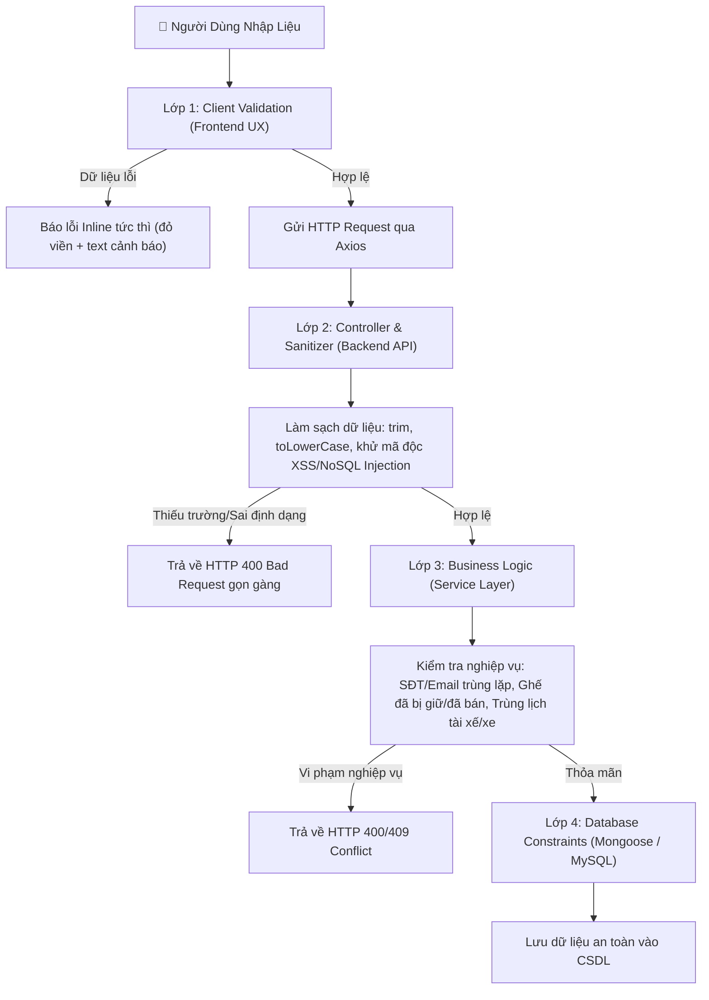
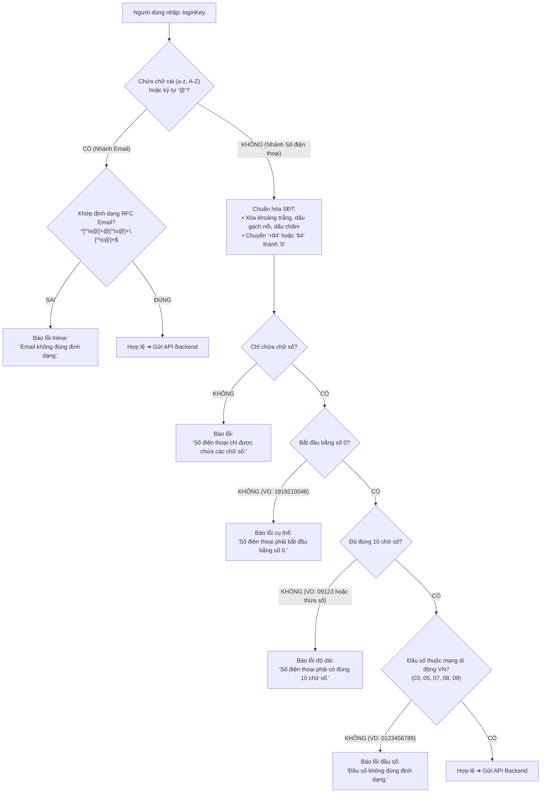
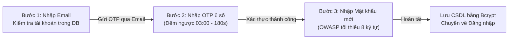

# KẾ HOẠCH & ĐẶC TẢ KIỂM TRA LOGIC NHẬP LIỆU TOÀN DIỆN
## HỆ THỐNG QUẢN LÝ NHÀ XE AN BÌNH LINES (KHOÁ LUẬN TỐT NGHIỆP)

> [!NOTE]
> Tài liệu này chuẩn hóa toàn bộ các quy tắc xác thực dữ liệu đầu vào (Input Validation), làm sạch dữ liệu (Data Sanitization) và kiểm soát toàn vẹn dữ liệu (Data Integrity) trên toàn hệ thống An Bình Lines, đảm bảo tiêu chuẩn an toàn thông tin và phục vụ nghiệm thu đề tài KLTN.

---

## I. KIẾN TRÚC KIỂM TRA DỮ LIỆU ĐA TẦNG (MULTI-LAYER VALIDATION)

Hệ thống tuân thủ nguyên tắc **"Không bao giờ tin tưởng dữ liệu từ phía Client" (Never Trust Client Input)** với mô hình xác thực 4 lớp:

---

## II. ĐẶC TẢ LOGIC NHẬP LIỆU CHI TIẾT THEO MODULE

### 1. MODULE XÁC THỰC & TÀI KHOẢN (AUTHENTICATION)

Áp dụng cho: Form Đăng nhập, Đăng ký, Đổi mật khẩu, Cập nhật thông tin cá nhân.

#### A. Đặc tả logic Form Đăng Nhập (Login Form - Customer App & Admin Dashboard)

Màn hình đăng nhập sử dụng **1 ô nhập liệu duy nhất cho cả Email và Số điện thoại** (`loginKey`), hệ thống áp dụng cơ chế **Nhận diện thông minh (Smart Detection)** theo thời gian thực:

* **Quy tắc kiểm tra chi tiết theo từng trường hợp:**

| Trường thông tin | Dữ liệu người dùng nhập | Nhánh nhận diện & Xử lý | Thông báo lỗi Inline hiển thị (Chữ đỏ) |
| :--- | :--- | :--- | :--- |
| **Tài khoản** | Bỏ trống hoàn toàn | Chưa nhập dữ liệu | *"Vui lòng nhập Email hoặc Số điện thoại."* (Admin: *"Vui lòng điền Số điện thoại hoặc Email nhân sự."*) |
| | Nhập chữ cái chưa có `@` (VD: `hovanloc.`) | Tự động nhận diện Email | *"Email không đúng định dạng."* |
| | Nhập email thiếu tên miền (VD: `loc@gmail`) | Kiểm tra regex Email | *"Email không đúng định dạng."* |
| | Nhập số **không bắt đầu bằng 0** (VD: `1919210046`) | Nhận diện SĐT (thiếu số 0) | **"Số điện thoại phải bắt đầu bằng số 0."** |
| | Nhập số thiếu hoặc thừa chữ số (VD: `09123` hoặc `091234567890`) | Nhận diện SĐT (sai độ dài) | **"Số điện thoại phải có đúng 10 chữ số."** |
| | Bắt đầu bằng 0, đủ 10 số nhưng sai nhà mạng (VD: `0123456789`) | Nhận diện SĐT (sai đầu số) | **"Đầu số không đúng định dạng."** |
| | Nhập định dạng quốc tế: `+84909123456` hoặc `0909 123 456` | Tự động làm sạch | Tự động chuẩn hóa thành `0909123456` và hợp lệ. |
| **Mật khẩu đăng nhập** | Bỏ trống | Kiểm tra trường bắt buộc | *"Vui lòng nhập mật khẩu."* (Admin: *"Vui lòng nhập mật khẩu truy cập."*) |
| | Dưới 8 ký tự (VD: `123456`) | Kiểm tra độ dài tối thiểu | *"Mật khẩu phải chứa tối thiểu 8 ký tự."* |
| | Đúng định dạng nhưng sai mật khẩu trong DB | Backend kiểm tra qua Bcrypt | *"Tài khoản hoặc mật khẩu không chính xác."* (Chuẩn bảo mật chống dò quét tài khoản) |

> [!TIP]
> **Trải nghiệm gõ phím mượt mà:** Mọi lỗi màu đỏ sẽ **lập tức biến mất ngay khi người dùng gõ phím** (`onChange`), không gây ức chế và người dùng không phải bấm xóa thủ công.

---

#### B. Đặc tả logic Form Đăng Ký & Đổi / Quên Mật Khẩu (Full OWASP Security)

Áp dụng tiêu chuẩn an ninh nghiêm ngặt **OWASP / NIST** ở cả Frontend lẫn Backend:

| Trường thông tin | Ràng buộc kỹ thuật | Quy tắc xác thực (Regex) | Thông báo lỗi chuẩn |
| :--- | :--- | :--- | :--- |
| **Họ và tên** | Bắt buộc; Từ 2 đến 50 ký tự; Không chứa số hoặc ký tự đặc biệt | Chữ cái Latin và chữ cái tiếng Việt có dấu, khoảng trắng | • Bỏ trống: *"Vui lòng nhập Họ và tên."* • Dưới 2 ký tự: *"Họ và tên phải có tối thiểu 2 ký tự."* • Quá 50 ký tự: *"Họ và tên không được vượt quá 50 ký tự."* • Chứa chữ số: *"Họ và tên không được chứa chữ số."* • Chứa ký tự lạ/đặc biệt: *"Họ và tên chỉ được chứa chữ cái và khoảng trắng."* |
| **Số điện thoại** | Bắt buộc; 10 số nhà mạng VN | Áp dụng hàm `validatePhoneInput` (kiểm tra số 0 ở đầu, độ dài 10 số, đầu số 03/05/07/08/09) | Phân tách lỗi chi tiết như bảng trên |
| **Email** | Bắt buộc (dùng để nhận OTP khôi phục mật khẩu & vé điện tử); Tối đa 100 ký tự; Định dạng chuẩn RFC | `^[a-zA-Z0-9._%+-]+@[a-zA-Z0-9.-]+\.[a-zA-Z]{2,}$` | • Bỏ trống: *"Vui lòng nhập Email."* • Sai định dạng: *"Email không đúng định dạng."* • Quá 100 ký tự: *"Email không được vượt quá 100 ký tự."* • Đã tồn tại trong DB: *"Email này đã được sử dụng."* |
| **Mật khẩu mới** | Bắt buộc; Từ 8 đến 32 ký tự theo chuẩn an ninh | Chứa đủ: 1 hoa (`A-Z`), 1 thường (`a-z`), 1 số (`0-9`), 1 ký tự đặc biệt (`@$!%*?&#_.-`) | • *"Mật khẩu phải chứa tối thiểu 8 ký tự."* • *"Mật khẩu phải chứa ít nhất 1 chữ cái in hoa (A-Z)."* • *"Mật khẩu phải chứa ít nhất 1 chữ cái in thường (a-z)."* • *"Mật khẩu phải chứa ít nhất 1 chữ số (0-9)."* • *"Mật khẩu phải chứa ít nhất 1 ký tự đặc biệt."* |
| **Xác nhận mật khẩu** | Bắt buộc khi Đăng ký / Đổi MK | Trùng khớp 100% với mật khẩu vừa nhập | *"Xác nhận mật khẩu không trùng khớp."* |

---

#### C. Quy trình Khôi phục Mật khẩu 3 Bước qua Email OTP (3 Phút Hiệu Lực)

Triệt tiêu hoàn toàn lỗ hổng chiếm đoạt tài khoản bằng quy trình xác thực 3 bước khép kín:

* **Bước 1 (Nhập Email & Gửi OTP):**
  - Người dùng nhập Email tài khoản $\rightarrow$ Hệ thống kiểm tra DB.
  - Nếu sai định dạng: *"Email không đúng định dạng."*
  - Nếu không tồn tại: *"Không tìm thấy tài khoản liên kết với email này."*
  - Nếu hợp lệ: Tạo mã OTP 6 số ngẫu nhiên, lưu bộ nhớ tạm với thời hạn **đúng 3 phút (180 giây)** và gửi email bảo mật đến người dùng.
* **Bước 2 (Xác thực OTP & Đồng hồ đếm ngược 3 phút):**
  - Ô nhập mã OTP 6 số tự động căn giữa to rõ.
  - Đồng hồ đếm ngược `03:00` chạy lùi theo thời gian thực.
  - **Nút "Gửi lại mã OTP":** Bị khóa (disable) và hiển thị thời gian chờ `Gửi lại sau (02:45)`. Chỉ khi hết 3 phút (`00:00`) nút mới mở khóa cho phép gửi lại mã mới.
  - Nếu nhập sai mã: *"Mã xác thực không chính xác."*
  - Nếu quá 3 phút: *"Mã xác thực đã hết hạn hoặc không tồn tại."*
  - Nếu đúng: Cấp `resetToken` dùng 1 lần trong 10 phút, chuyển sang Bước 3.
* **Bước 3 (Thiết lập mật khẩu mới):**
  - Nhập Mật khẩu mới & Xác nhận mật khẩu mới.
  - Ràng buộc: Tuân thủ chuẩn bảo mật OWASP tối thiểu 8 ký tự, 1 hoa, 1 thường, 1 số, 1 ký tự đặc biệt.
  - Bấm hoàn tất: Backend hash Bcrypt và lưu vào MongoDB, thông báo *"Đặt lại mật khẩu thành công! Bạn có thể đăng nhập ngay."*, đóng modal và đưa về form đăng nhập.

---

### 2. MODULE TÌM KIẾM & ĐẶT VÉ XE (BOOKING PROCESS)

Áp dụng cho: Màn hình Tìm chuyến xe, Sơ đồ ghế, Điền thông tin hành khách & Thanh toán.

#### A. Tìm kiếm chuyến xe
* **Điểm đi & Điểm đến:**
  * Bắt buộc chọn từ danh sách trạm/bến hợp lệ của nhà xe.
  * **Ràng buộc:** Điểm đi $\neq$ Điểm đến. Nếu người dùng chọn trùng ➔ Khóa nút tìm kiếm và thông báo: *"Điểm đến không được trùng với điểm xuất phát."*
* **Ngày khởi hành:**
  * **Ràng buộc:** `Ngày đi >= Ngày hiện tại`.
  * Không cho phép chọn ngày trong quá khứ (khóa trên giao diện DatePicker qua `min={today}`).
  * Giới hạn đặt trước tối đa 60 ngày.

#### B. Chọn ghế & Giữ chỗ Real-time
* **Số lượng ghế:** Tối thiểu 1 ghế, tối đa 5 ghế/lần giao dịch để chống đầu cơ vé.
* **Trạng thái ghế:** Phải là ghế trống (`status: available`).
* **Cơ chế khóa giữ chỗ (5 phút):**
  * Ghế vừa chọn được đẩy vào danh sách `lockedSeats` qua **Server-Sent Events (SSE)** và Redis cache.
  * Bộ đếm ngược 5:00 hiển thị ở góc màn hình. Nếu hết 5 phút không hoàn tất ➔ Hệ thống tự động phát lệnh mở khóa (`unlock-all-my-seats`), đưa ghế về trạng thái trống cho người khác.

#### C. Phân quyền Khách Vãng Lai vs Khách Thành Viên
* **Khách thành viên (Đã đăng nhập):**
  * Cho phép sử dụng Voucher giảm giá hợp lệ.
  * Cho phép dùng điểm tích lũy: $1 \text{ điểm} = 1.000 \text{ VNĐ}$, tối đa giảm 50% tổng đơn hàng.
  * Được quyền chọn: Thanh toán ngay (VietQR PayOS) HOẶC Giữ chỗ thanh toán sau (trong vòng 5 ngày).
* **Khách vãng lai (Không đăng nhập):**
  * **Chặn hoàn toàn Voucher & Điểm:** Ẩn hoặc khóa ô nhập voucher/điểm thưởng, giá trị giảm trừ luôn gán cứng $= 0$.
  * **Chặn Thanh toán sau:** Bắt buộc thanh toán trực tuyến ngay qua VietQR/PayOS để tránh đặt ảo giữ chỗ.

---

### 3. MODULE GIAO NHẬN HÀNG HÓA (SHIPMENT / LOGISTICS)

Áp dụng cho: Trang Ký gửi bưu kiện & Tra cứu vận đơn.

| Tiêu chí | Quy tắc xác thực | Xử lý chống lỗi |
| :--- | :--- | :--- |
| **Người gửi & Người nhận** | • Tên người gửi, SĐT người gửi hợp lệ. • Tên người nhận, SĐT người nhận hợp lệ. • **SĐT người gửi $\neq$ SĐT người nhận.** | Ngăn chặn hành vi nhập cùng 1 số điện thoại cho cả 2 bên gây khó khăn cho tài xế khi liên hệ giao hàng. |
| **Khối lượng hàng** | Số thực $> 0$; Tối thiểu 0.5 kg, tối đa 100 kg/kiện. | Tự động tính cước vận chuyển chuẩn theo công thức: $\text{Cước} = \text{Khối lượng} \times \text{Đơn giá tuyến}$. |
| **Mô tả hàng hóa** | Bắt buộc; Tối thiểu 5 ký tự (VD: Hồ sơ, quần áo, trái cây,...). | Kiểm tra danh mục từ khóa cấm/hàng nguy hiểm (chất nổ, xăng dầu, chất cấm). |

---

### 4. MODULE QUẢN TRỊ ĐIỀU HÀNH (ADMIN DASHBOARD)

Áp dụng cho: Điều hành đội xe, Phân tài xế, Tạo chuyến xe mới.

* **Tạo chuyến xe (Create Trip):**
  * **Kiểm tra xung đột tài xế (Driver Conflict Check):** Một tài xế không được phân công vào 2 chuyến xe có khung giờ xuất bến và đến dự kiến giao nhau.
  * **Kiểm tra xung đột xe (Bus Conflict Check):** Một biển số xe không thể chạy 2 chuyến cùng thời điểm.
  * **Loại xe & Bằng lái:** Tài xế lái xe Limousine/Giường nằm 40+ chỗ phải có bằng lái hạng D hoặc E còn hạn.
* **Thời gian biểu:**
  * Giờ đến dự kiến (`arrivalTime`) phải lớn hơn Giờ khởi hành (`departureTime`) ít nhất bằng thời lượng tuyến đường (`duration`).

---

## III. MA TRẬN KỊCH BẢN KIỂM THỬ (TEST CASES MATRIX)

Bảng ma trận này dùng để đối chiếu khi nghiệm thu và đưa trực tiếp vào chương Kiểm thử trong báo cáo KLTN:

| Mã Test | Mô tả kịch bản kiểm thử | Dữ liệu đầu vào giả định | Kết quả mong đợi (Expected Result) | Trạng thái |
| :---: | :--- | :--- | :--- | :---: |
| **TC_AUTH_01** | Bấm Đăng nhập khi để trống toàn bộ form | `loginKey = ""`, `password = ""` | Báo đỏ inline tại cả 2 ô. Chặn gửi API lên server. | ✅ Đạt |
| **TC_AUTH_02** | Nhập chữ cái chưa có `@` hoặc thiếu domain | `loginKey = "hovanloc."`, `password = "Anbinh@2026"` | Nhận diện Email ➔ Báo lỗi: *"Email không đúng định dạng"*. | ✅ Đạt |
| **TC_AUTH_03a** | Nhập số điện thoại **không bắt đầu bằng số 0** | `loginKey = "1919210046"`, `password = "Anbinh@2026"` | Nhận diện SĐT ➔ Báo lỗi cụ thể: **"Số điện thoại phải bắt đầu bằng số 0"**. | ✅ Đạt |
| **TC_AUTH_03b** | Nhập số điện thoại thiếu số (dưới 10 chữ số) | `loginKey = "09123"`, `password = "Anbinh@2026"` | Nhận diện SĐT ➔ Báo lỗi: **"Số điện thoại phải có đúng 10 chữ số"**. | ✅ Đạt |
| **TC_AUTH_03c** | Nhập số điện thoại thừa số (trên 10 chữ số) | `loginKey = "091234567890"`, `password = "Anbinh@2026"` | Nhận diện SĐT ➔ Báo lỗi: **"Số điện thoại phải có đúng 10 chữ số"**. | ✅ Đạt |
| **TC_AUTH_03d** | Bắt đầu bằng 0, đủ 10 số nhưng sai mạng di động | `loginKey = "0123456789"`, `password = "Anbinh@2026"` | Nhận diện SĐT ➔ Báo lỗi: **"Đầu số không đúng định dạng"**. | ✅ Đạt |
| **TC_AUTH_03e** | Nhập SĐT chứa dấu gạch ngang hoặc mã vùng quốc tế | `loginKey = "+84 909-123-456"`, `password = "Anbinh@2026"` | Hệ thống tự làm sạch thành `0909123456` hợp lệ và gửi đăng nhập. | ✅ Đạt |
| **TC_AUTH_04** | Nhập mật khẩu dưới 8 ký tự | `loginKey = "0909123456"`, `password = "123456"` | Báo đỏ inline: **"Mật khẩu phải chứa tối thiểu 8 ký tự"**. Chặn gửi API. | ✅ Đạt |
| **TC_AUTH_05** | Nhập email có khoảng trắng và viết hoa bất kỳ | `loginKey = "  HoVanLoc.lv@GMAIL.com "`, đúng mật khẩu | Hệ thống tự `trim()` và chuyển chữ thường, đăng nhập thành công. | ✅ Đạt |
| **TC_AUTH_06** | Nhập sai mật khẩu | `loginKey = "hovanloc.lv@gmail.com"`, sai mật khẩu | Báo lỗi: *"Tài khoản hoặc mật khẩu không chính xác"*. Server log 1 dòng sạch sẽ, không bung stack trace. | ✅ Đạt |
| **TC_AUTH_07** | Đăng ký với mật khẩu thiếu chữ hoa hoặc ký tự đặc biệt | `password = "test12345"` | Báo lỗi chuẩn OWASP: yêu cầu đủ chữ hoa, thường, số, ký tự đặc biệt. | ✅ Đạt |
| **TC_REG_NAME_01** | Bỏ trống Họ và tên khi bấm Đăng ký | `regName = ""` | Báo lỗi inline: *"Vui lòng nhập Họ và tên."* | ✅ Đạt |
| **TC_REG_NAME_02** | Nhập Họ và tên dưới 2 ký tự | `regName = "A"` | Báo lỗi inline: *"Họ và tên phải có tối thiểu 2 ký tự."* | ✅ Đạt |
| **TC_REG_NAME_03** | Nhập Họ và tên chứa chữ số | `regName = "Nguyen Van 123"` | Báo lỗi inline: *"Họ và tên không được chứa chữ số."* | ✅ Đạt |
| **TC_REG_NAME_04** | Nhập Họ và tên chứa ký tự đặc biệt | `regName = "Nguyen Van @#$"` | Báo lỗi inline: *"Họ và tên chỉ được chứa chữ cái và khoảng trắng."* | ✅ Đạt |
| **TC_REG_NAME_05** | Nhập Họ và tên tiếng Việt có dấu hợp lệ | `regName = "Nguyễn Văn An"` | Hợp lệ, cho phép gửi đăng ký thành công. | ✅ Đạt |
| **TC_REG_EMAIL_01** | Bỏ trống ô Email khi đăng ký | `regEmail = ""` | Báo lỗi inline: *"Vui lòng nhập Email."* | ✅ Đạt |
| **TC_REG_EMAIL_02** | Nhập Email sai định dạng (thiếu @, thiếu domain) | `regEmail = "abc@gmail"` | Báo lỗi inline: *"Email không đúng định dạng."* | ✅ Đạt |
| **TC_REG_EMAIL_03** | Nhập Email đã được người khác sử dụng | `regEmail = "hovanloc.lv@gmail.com"` | Backend báo lỗi: *"Email này đã được sử dụng."* | ✅ Đạt |
| **TC_FORGOT_01** | Nhập email không tồn tại trong hệ thống | `forgotEmail = "notfound@example.com"` | Báo lỗi: *"Không tìm thấy tài khoản liên kết với email này."* | ✅ Đạt |
| **TC_FORGOT_02** | Nhập email hợp lệ để nhận mã OTP | `forgotEmail = "hovanloc.lv@gmail.com"` | Gửi OTP 6 số qua email, chuyển sang Bước 2, bật đếm ngược 180s (3 phút). | ✅ Đạt |
| **TC_FORGOT_03** | Bấm gửi lại mã khi chưa hết 3 phút | `forgotTimer > 0` (đang đếm ngược) | Nút bị khóa, hiển thị thời gian còn lại: `Gửi lại sau (MM:SS)`. | ✅ Đạt |
| **TC_FORGOT_04** | Nhập sai mã xác thực OTP | `forgotOtp = "000000"` | Báo lỗi: *"Mã xác thực không chính xác."* | ✅ Đạt |
| **TC_FORGOT_05** | Nhập mã xác thực khi đã quá 3 phút (hết hạn) | Mã gửi quá 180 giây | Báo lỗi: *"Mã xác thực đã hết hạn hoặc không tồn tại."* | ✅ Đạt |
| **TC_FORGOT_06** | Xác thực OTP đúng và đặt mật khẩu mới | `forgotOtp` đúng, `newPass = "Anbinh@2026"` | Cập nhật mật khẩu mã hóa Bcrypt vào MongoDB, đưa người dùng về đăng nhập. | ✅ Đạt |
| **TC_SEARCH_FLEX_01** | Tìm kiếm chỉ theo Ngày đi (bỏ trống Điểm đi & Điểm đến) | `from = ""`, `to = ""`, `date = "2026-12-13"` | Hiển thị toàn bộ tất cả chuyến xe hoạt động trong ngày được chọn. | ✅ Đạt |
| **TC_SEARCH_FLEX_02** | Tìm kiếm chỉ theo Điểm đi + Ngày đi (bỏ trống Điểm đến) | `from = "Đà Lạt"`, `to = ""`, `date = "2026-12-13"` | Hiển thị tất cả chuyến xe xuất bến từ Đà Lạt đến mọi nơi trong ngày. | ✅ Đạt |
| **TC_SEARCH_FLEX_03** | Tìm kiếm chỉ theo Điểm đến + Ngày đi (bỏ trống Điểm đi) | `from = ""`, `to = "Hồ Chí Minh"`, `date = "2026-12-13"` | Hiển thị tất cả chuyến xe về Hồ Chí Minh từ mọi nơi trong ngày. | ✅ Đạt |
| **TC_BOOK_01** | Chọn Điểm đến trùng với Điểm xuất phát | `from = "Đà Lạt"`, `to = "Đà Lạt"` | Báo lỗi: *"Điểm đến không được trùng với điểm xuất phát"*. Không tìm chuyến. | ✅ Đạt |
| **TC_BOOK_02** | Đặt vé khi chưa chọn ghế ngồi | Chọn chuyến xe nhưng `selectedSeats = []` | Báo cảnh báo: *"Vui lòng chọn ít nhất một ghế ngồi"*. | ✅ Đạt |
| **TC_BOOK_03** | Khách vãng lai cố tình nhập điểm hoặc voucher | `isGuestBooking = true`, `voucherCode = "GIAM20"` | Giao diện ẩn/khóa form voucher & điểm; Backend ép buộc `pointsUsed=0`, `voucherCode=""`. | ✅ Đạt |
| **TC_BOOK_04** | Khách vãng lai chọn thanh toán sau | `isGuestBooking = true`, click "Thanh toán sau" | Ẩn hoàn toàn nút thanh toán sau; Backend trả lỗi 400 nếu gửi lậu request. | ✅ Đạt |
| **TC_UI_TIER_01** | Ẩn huy hiệu / thẻ hạng thành viên khi đặt vé | Người dùng thành viên đăng nhập đặt vé | Không hiển thị thẻ `⭐ Đang đặt vé với tài khoản thành viên (Hạng: Platinum)`, form thông tin gọn gàng. | ✅ Đạt |
| **TC_UI_TRIPTYPE_01** | Loại bỏ nút chọn radio Một chiều / Khứ hồi | Người dùng tìm kiếm trên Trang chủ và Trang chuyến xe | Đã loại bỏ radio "Một chiều" và "Khứ hồi", giao diện tìm kiếm tối giản, tập trung vào lộ trình. | ✅ Đạt |
| **TC_UI_RESET_FILTER_01** | Nút làm mới bộ lọc tìm kiếm | Bấm nút "Làm mới" trên thanh tìm kiếm hoặc "Làm mới bộ lọc tìm kiếm" ở cột bộ lọc | Đặt lại toàn bộ tiêu chí lọc (mức giá, giờ chạy, loại xe, điểm đón/trả, sắp xếp) về mặc định. | ✅ Đạt |
| **TC_UI_MOBILE_COMPACT_01** | Tối ưu hóa giao diện di động & xóa bộ lọc cồng kềnh | Xem trên màn hình điện thoại (<= 768px, iPhone, Android) | Xóa cột bộ lọc chiếm chỗ; Form tìm kiếm 2x2 siêu gọn; Thẻ chuyến xe ngang phong cách app đặt xe (140px/thẻ), hiển thị 2-3 chuyến/màn hình. | ✅ Đạt |
| **TC_UI_AMENITIES_MORE_01** | Tiện ích thu gọn & xem thêm nếu nhiều | Chuyến xe có trên 4 tiện ích | Mặc định chỉ hiển thị 4 tiện ích đầu kèm nút `+X xem thêm`, bấm để mở rộng/thu gọn, giữ thẻ xe gọn gàng 1 dòng. | ✅ Đạt |
| **TC_UI_BTN_COMPACT_01** | Tinh gọn nút Chọn chỗ | Xem trên Desktop & Mobile | Nút "Chọn chỗ →" được tinh chỉnh vừa vặn (`height: 32px - 38px`), cân đối hài hòa với phần hiển thị giá tiền. | ✅ Đạt |
| **TC_UI_PAGINATION_CENTER_01**| Căn giữa thanh thông tin số lượng chuyến & phân trang | Cuối danh sách chuyến xe ("Hiển thị X trong Y chuyến") | Toàn bộ dòng thông báo và cụm nút `< 1 >` được căn giữa màn hình (center) trên cả máy tính và điện thoại. | ✅ Đạt |
| **TC_UI_REMOVE_POLICY_TAB_01**| Gỡ bỏ tab Chính sách trong Thông tin chi tiết chuyến xe | Bấm xem Thông tin chi tiết của chuyến xe | Đã xóa tab "Chính sách", danh sách tab chỉ còn "Điểm đón, trả", "Tiện ích" và "Đánh giá", tinh gọn nội dung. | ✅ Đạt |
| **TC_UI_BACK_BTN_ICON_01**    | Tối ưu nút Quay lại sơ đồ ghế thành icon mũi tên | Bấm chọn chỗ xem sơ đồ ghế trên Mobile | Nút "Quay lại danh sách" được thay bằng icon mũi tên `[ ← ]` bo góc hiện đại, không bị gãy/rớt dòng chữ. | ✅ Đạt |
| **TC_UI_DESIGN_MATCH_REFERENCE_01** | Đồng bộ toàn diện layout Desktop chuẩn theo thiết kế mẫu (Hình 1) | Xem trên PC / Desktop | Đồng bộ chiều rộng `1120px` cho khung tìm kiếm, thanh kết quả trắng bo góc và các thẻ xe; Hiển thị nhãn tuyến đường góc phải (`Tuyến đường: ...`); Thanh lộ trình ngang chuẩn với 2 điểm tròn xanh và mốc giờ nổi bật; Căn đối hoàn hảo tỷ lệ thẻ. | ✅ Đạt |
| **TC_UI_HOMEPAGE_RESET_FILTER_01**  | Nút Làm mới bộ lọc tìm kiếm trên Trang chủ | Bấm "Làm mới" trên SearchBox Trang chủ | Đặt lại Điểm đi = rỗng, Điểm đến = rỗng, Ngày đi = ngày hiện tại, Số lượng vé = 1 vé một cách tức thì. | ✅ Đạt |
| **TC_UI_HOMEPAGE_MOBILE_01**        | Tối ưu giao diện Trang chủ toàn diện trên điện thoại (Mobile) | Xem Trang chủ trên iPhone 14 Pro Max / Android | Form tìm kiếm 2x2 siêu gọn (`~140px`), 2 nút [Tìm chuyến xe] [Làm mới] song song; 2 thẻ thao tác nhanh 2 cột; Lộ trình xe gọn gàng; 4 lý do chọn nhà xe xếp lưới 2x2 đẹp mắt (không còn cuộn dài lê thê); Footer 2 cột tinh giản. | ✅ Đạt |
| **TC_UI_HOMEPAGE_SEARCHBOX_MATCH_01**| Đồng bộ 100% cấu trúc & giao diện bộ lọc Trang chủ y hệt Trang Trips (Hình 1) | Xem trên PC / Desktop | Dàn 1 hàng ngang duy nhất (`grid-template-columns: 1.2fr 1.2fr 1fr 1fr auto`), các trường `ĐIỂM ĐI`, `ĐIỂM ĐẾN` (icon đỏ), `NGÀY ĐI`, `SỐ VÉ` (1 vé, 2 vé,...) và 2 nút `[Tìm xe]` + `[Làm mới]` cùng nằm trên 1 hàng phẳng tinh tế. | ✅ Đạt |
| **TC_AI_LANDMARK_01**                | Tìm kiếm địa danh nổi tiếng (Landmark 81, Hồ Xuân Hương, Bến Ninh Kiều, Cầu Rồng...) | Gõ tên danh lam / địa danh vào ô Điểm đi / Điểm đến | Dropdown tức thì hiển thị nhóm `✨ ĐỊA DANH THÔNG MINH (AI)` kèm huy hiệu `AI GỢI Ý` và dòng hướng dẫn `➔ Thuộc [Tỉnh/TP] (Đón/trả tại: [Trạm gần nhất])`. Bấm chọn tự động gán tỉnh thành tương ứng. | ✅ Đạt |
| **TC_AI_LANDMARK_BANNER_01**         | Banner AI thông minh trên trang danh sách chuyến xe khi tìm bằng địa danh | Chuyển sang TripsPage sau khi chọn gợi ý AI | Hiển thị Banner màu tím thẩm mỹ: *"✨ AI Đã Tối Ưu Lộ Trình: [Địa danh] thuộc [Tỉnh/TP] - Các chuyến xe có điểm đón/trả thuận tiện nhất tại [Trạm]"*. | ✅ Đạt |
| **TC_AI_UNMET_DEMAND_LOG_01**        | Tự động ghi nhận log nhu cầu khi tìm kiếm trả về 0 chuyến xe | Người dùng tìm kiếm chặng chưa có xe chạy hoặc hết chuyến | Hệ thống tự động ghi nhận bản ghi non-blocking vào MongoDB `RouteDemandLog` (`fromNormalized`, `toNormalized`, `searchDate`, `passengers`, `hasResults=false`). | ✅ Đạt |
| **TC_AI_GM_DEMAND_SENSING_01**       | Bảng thống kê Nhu cầu Mở Tuyến Mới trên Admin Dashboard Giám đốc | Mở `GmAnalysisPage.js` tab "✨ Nhu cầu Mở Tuyến Mới (AI Demand Sensing)" | Hiển thị 4 KPI card và Bảng xếp hạng Real-time các chặng được tìm kiếm nhiều nhất; Tự động phân loại mức độ khẩn cấp (🔴 Nhu cầu Rất Cao $\ge 30$ lượt/tháng, 🟡 Tiềm năng $\ge 15$ lượt/tháng). | ✅ Đạt |
| **TC_AI_GM_EXPANSION_ADVISOR_01**    | Trợ lý Gemini AI Cố vấn Chiến lược Mở Tuyến Mới cho Ban Giám đốc | Bấm nút "✨ Hỏi AI" tại một chặng đường trong bảng nhu cầu | Modal phân tích chuyên sâu của Gemini AI hiển thị: Điểm khả thi (88/100), Cự ly & thời gian đi, Dòng xe tối ưu (Limousine 9 chỗ / Ghế ngồi 29 chỗ), Biểu giá vé đề xuất, Dự toán doanh thu tháng, Khung giờ xuất bến và Kế hoạch khảo sát 3 bước. | ✅ Đạt |
| **TC_SHIP_01** | Nhập trùng số điện thoại người gửi và người nhận | `senderPhone = "0829927690"`, `receiverPhone = "0829927690"` | Báo lỗi: *"Số điện thoại người nhận không được trùng với người gửi"*. | ✅ Đạt |
| **TC_ADMIN_01** | Phân cùng 1 tài xế vào 2 chuyến chạy cùng giờ | `driverId: "D01"` vào 2 chuyến lúc 22:30 ngày 13/11 | Hệ thống phát hiện xung đột lịch và chặn lưu chuyến xe. | ✅ Đạt |

---

## IV. LỘ TRÌNH THỰC HIỆN TIẾP THEO

1. **Bước 1 (Đã hoàn thành):** Chuẩn hóa toàn bộ validation Đăng nhập / Đăng ký ở `AuthPage.js`, `authController.js` và `authService.js`.
2. **Bước 2:** Rà soát và áp dụng chuẩn báo lỗi Inline cho form thông tin khách hàng ở `TripsPage.js` (Họ tên, SĐT nhận vé, Điểm đón/trả).
3. **Bước 3:** Áp dụng chuẩn kiểm tra cho form Ký gửi hàng hóa ở `ShipmentPage.js`.
4. **Bước 4:** Xuất bản tài liệu này vào phụ lục kiểm thử của báo cáo Khóa luận tốt nghiệp.
