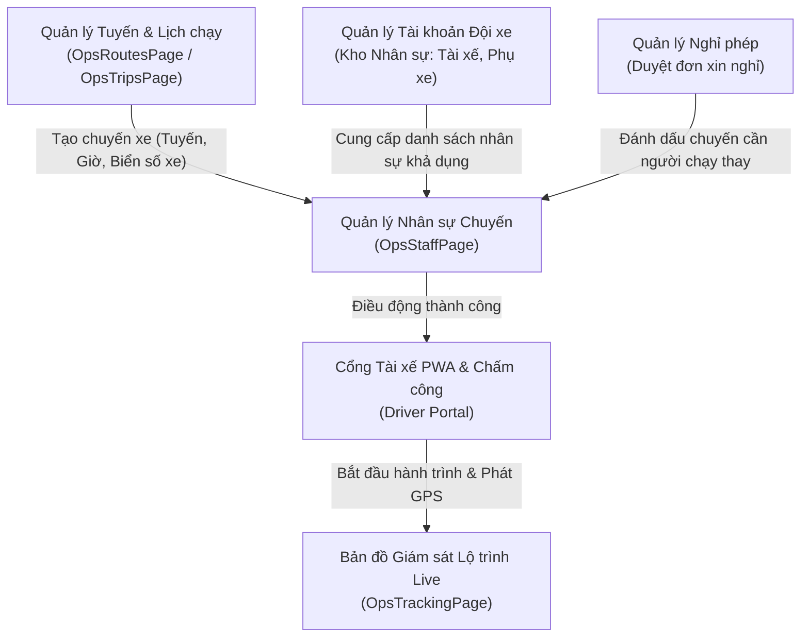
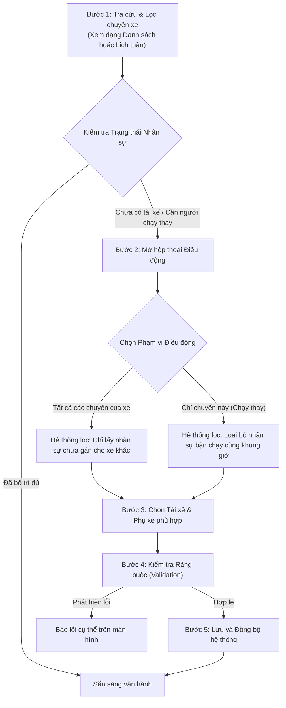

# Tài liệu Nghiệp vụ và Quy trình: Chức năng Quản lý Nhân sự Chuyến xe

## 1. Giới thiệu tổng quan về Chức năng

Chức năng **Quản lý nhân sự chuyến** (tại giao diện Điều hành Vận tải - [OpsStaffPage.js](file:///c:/Users/VanLoc/OneDrive%20-%20Industrial%20University%20of%20HoChiMinh%20City/Documents/KLTN/HeThongQuanLyNhaXe/frontend/admin-dashboard/src/pages/ops/OpsStaffPage.js)) là phân hệ cốt lõi dành cho bộ phận Điều độ và Quản lý Vận tải của nhà xe.

Nhiệm vụ trọng tâm của chức năng này là:
1. **Phân công và điều động nhân sự**: Gán Tài xế chính (Driver) và Phụ xe/Tiếp viên (Attendant/Assistant) cho từng chuyến xe được khai thác.
2. **Kiểm soát tính sẵn sàng và xung đột**: Đảm bảo mỗi chuyến xe xuất bến đều có đủ nhân sự vận hành hợp lệ, không bị trùng lịch chạy và tuân thủ đúng quy định về an toàn vận tải.
3. **Xử lý tình huống phát sinh (Chạy thay / Dự bị)**: Kịp thời bố trí nhân sự dự bị thay thế khi tài xế hoặc phụ xe chính thức có việc đột xuất hoặc xin nghỉ phép.

---

## 2. Vị trí trong Hệ sinh thái Quản lý Nhà xe

1. **Đầu vào (Inputs)**:
   - Danh sách chuyến xe cần chạy từ phân hệ Quản lý chuyến xe.
   - Danh mục phương tiện và tình trạng kỹ thuật từ Quản lý đội xe.
   - Danh sách tài xế và phụ xe đang ở trạng thái hoạt động (`active`) từ phân hệ Quản lý nhân viên.
   - Dữ liệu đơn xin nghỉ phép đã được phê duyệt từ phân hệ Nhân sự.
2. **Đầu ra (Outputs)**:
   - Chuyến xe có đầy đủ thông tin định danh của Tài xế chính và Phụ xe (Họ tên, Số điện thoại liên hệ).
   - Lịch chạy hiển thị trực tiếp trên thiết bị của tài xế để thực hiện điểm danh khuôn mặt, kiểm tra xe và xuất bến.

---

## 3. Hai Chế độ Nghiệp vụ Điều động Nhân sự

Hệ thống thiết kế theo thực tế vận hành đặc thù của ngành vận tải hành khách đường dài với hai cơ chế rõ rệt:

### 3.1. Chế độ 1: Điều động Tổ lái Cố định (1 Xe khách gắn liền 1 Cặp Tài xế & Phụ xe)
- **Bản chất nghiệp vụ**: 
  - Trong thực tế, mỗi chiếc xe khách giường nằm hoặc xe limousine thường được giao khoán trực tiếp cho một tổ lái chuyên trách (1 tài xế chính và 1 phụ xe).
  - Điều này giúp tài xế gắn bó, nắm rõ tình trạng kỹ thuật của phương tiện, bảo quản nội thất xe và tối ưu hóa việc quản lý tài sản.
- **Quy tắc hệ thống**:
  - Khi điều độ viên chọn phạm vi áp dụng là **"Toàn bộ các chuyến của phương tiện này"** (`applyScope === 'all'`): Hệ thống sẽ gán tổ lái được chọn vào tất cả các chuyến xe hiện tại và các chuyến lặp lại hàng tuần trong tương lai của chiếc xe đó.
  - **Ràng buộc chống xung đột**: Hệ thống kiểm tra trong cơ sở dữ liệu ([tripController.js](file:///c:/Users/VanLoc/OneDrive%20-%20Industrial%20University%20of%20HoChiMinh%20City/Documents/KLTN/HeThongQuanLyNhaXe/backend/controllers/tripController.js#L952-L981)). Nếu tài xế này hoặc phụ xe này đã được gán cố định cho một chiếc xe khác, hệ thống sẽ ngăn chặn và thông báo: *"Tài xế [Tên] đã được phân công lái xe khác ([Biển số]). Một tài xế chỉ được chạy một chiếc xe duy nhất."*

### 3.2. Chế độ 2: Điều động Chạy thay Tạm thời (Reliever Mode)
- **Bản chất nghiệp vụ**:
  - Áp dụng khi tài xế chính thức của xe bị ốm, gặp sự cố gia đình hoặc đã được duyệt đơn nghỉ phép vào một ngày cụ thể.
  - Chuyến xe đó sẽ tự động được gắn cờ **Cần người chạy thay** (`needsReplacement = true`).
- **Quy tắc hệ thống**:
  - Khi điều độ viên chọn phạm vi **"Chỉ áp dụng cho chuyến này"** (`applyScope === 'single'`): Hệ thống hiểu đây là nhân sự chạy thay tạm thời (`isReliever = true`).
  - **Ràng buộc thời gian thực**: Hệ thống quét kiểm tra toàn bộ các chuyến xe khác trong cơ sở dữ liệu. Nếu nhân sự dự bị được chọn đang bận chạy một chuyến xe khác có khung giờ chồng lấn (`departureTime < tripEnd && arrivalTime > tripStart`), hệ thống sẽ từ chối và báo lỗi ngay lập tức: *"Tài xế dự bị [Tên] đang bận chạy một chuyến khác trong khung giờ này."*
  - **Tính độc lập**: Việc gán người chạy thay chỉ thay đổi nhân sự của đúng chuyến xe trong ngày hôm đó. Các chuyến xe của chiếc xe này vào các tuần tiếp theo vẫn tự động giữ nguyên tổ lái cố định ban đầu mà không bị ảnh hưởng.

---

## 4. Quy trình Vận hành Điều động Từng bước (Operational Workflow)

### Chi tiết các bước thực hiện của Điều độ viên:
1. **Bước 1: Giám sát trạng thái chuyến**:
   - Điều độ viên mở trang Quản lý nhân sự chuyến.
   - Có thể lọc theo Tuyến đường, Phương tiện, Ngày chạy hoặc Trạng thái (`Tất cả`, `Đã bố trí`, `Chưa đủ nhân sự`).
   - Có thể chuyển đổi linh hoạt giữa:
     - **Dạng Danh sách**: Xem chi tiết bảng phẳng, phù hợp tra cứu nhanh theo ngày.
     - **Dạng Lịch tuần**: Xem phân bổ 7 ngày trong tuần từ Thứ Hai đến Chủ Nhật, giúp nhìn nhận tổng thể tải công việc của đội ngũ.
2. **Bước 2: Mở hộp thoại Điều động**:
   - Nhấn nút "Điều động" tại hàng chuyến xe cần xử lý.
   - Cửa sổ phân công xuất hiện với đầy đủ thông tin: Tuyến đường, Giờ xuất bến, Biển số xe, Loại xe.
3. **Bước 3: Lựa chọn nhân sự**:
   - Chọn Tài xế chính từ danh sách thả xuống (bắt buộc).
   - Chọn Phụ xe từ danh sách thả xuống (tùy chọn theo loại xe).
   - Danh sách tài xế/phụ xe được hệ thống tự động lọc thông minh:
     - Nếu xe đã có tổ lái chuyên trách: Tự động điền sẵn tên của họ.
     - Nếu là chế độ chạy thay: Tự động loại bỏ những ai đang bận chạy chuyến khác trong khoảng thời gian đó.
4. **Bước 4: Xác nhận điều động**:
   - Nhấn "Xác nhận điều động".
   - Hệ thống tiến hành kiểm tra toàn diện các quy tắc ràng buộc (Validation) trước khi lưu.
   - Khi hợp lệ, hệ thống phản hồi thông báo thành công và cập nhật tức thời nhãn trạng thái của chuyến xe thành `Đã bố trí`.

---

## 5. Quy tắc Bắt lỗi và Ràng buộc Điều động (Validation & Error Handling)

Hệ thống thiết lập bộ kiểm tra chặt chẽ cả ở giao diện người dùng (Front-end) lẫn máy chủ (Back-end) để đảm bảo không xảy ra sai sót trong vận hành:

1. **Bắt buộc có Tài xế chính**:
   - Không cho phép bỏ trống Tài xế chính khi lưu điều động.
   - Nếu điều độ viên chưa chọn: Hệ thống báo lỗi *"Vui lòng chọn Tài xế chính trước khi xác nhận điều động."*
2. **Chống trùng lặp giữa Tài xế chính và Phụ xe**:
   - Một người không thể vừa lái xe vừa làm tiếp viên/phụ xe trên cùng một chuyến.
   - Nếu điều độ viên chọn cùng một người cho cả 2 vị trí: Hệ thống chặn ngay và báo lỗi *"Tài xế chính và Phụ xe không thể là cùng một người ([Tên]). Vui lòng chọn người phụ xe khác."*
3. **Chống phân công chuyến xe trong quá khứ**:
   - Không cho phép thay đổi hay điều động nhân sự vào các chuyến xe đã hoàn thành lộ trình trong quá khứ.
   - Hệ thống kiểm tra: Nếu `arrivalTime < now`, cảnh báo *"Chuyến xe này đã hoàn thành lộ trình trong quá khứ. Không thể điều động nhân sự."*
4. **Chống trùng lịch chạy khi Chạy thay (Reliever Time Overlap)**:
   - Trong chế độ chạy thay (`applyScope === 'single'`), hệ thống kiểm tra toàn bộ chuyến xe trong cùng ngày.
   - Nếu tài xế dự bị đang bận điều khiển một chuyến xe khác trong khoảng thời gian khởi hành đến khi kết thúc, hệ thống chặn lại và chỉ rõ: *"Tài xế [Tên] đang bận điều khiển tuyến [Tuyến khác] (khởi hành [Giờ]) trong khung giờ này."*
   - Kiểm tra tương tự đối với Phụ xe dự bị.
5. **Chống trùng xe chuyên trách khi Điều động cố định**:
   - Trong chế độ cố định (`applyScope === 'all'`), hệ thống kiểm tra xem tài xế hoặc phụ xe này đã được gán chuyên trách cho phương tiện nào khác chưa.
   - Nếu đã có xe chuyên trách: Hệ thống chặn lại và báo lỗi *"Tài xế [Tên] đã được phân công cố định cho xe [Biển số]. Mỗi tài xế chỉ được phụ trách một xe chuyên trách."*

---

## 6. Ý nghĩa và Lợi ích mang lại

1. **Ngăn ngừa 100% lỗi xung đột con người**: Không bao giờ xảy ra tình trạng 1 tài xế bị xếp lái 2 chiếc xe cùng một thời điểm.
2. **Chuyên môn hóa phương tiện**: Tôn trọng nguyên tắc 1 xe gắn liền 1 tổ lái, nâng cao trách nhiệm giữ gìn phương tiện của nhân viên.
3. **Ứng phó linh hoạt khi có sự cố**: Cơ chế chạy thay tạm thời cho phép xử lý ngay các ca xin nghỉ đột xuất mà không làm xáo trộn lịch chạy dài hạn của nhà xe.
4. **Kết nối liền mạch**: Dữ liệu điều động tại đây là cơ sở trực tiếp để tài xế đăng nhập ứng dụng PWA, thực hiện xác thực khuôn mặt AI (Face API) khi điểm danh ca trực và xuất bến an toàn.
