# BÁO CÁO CẤU TRÚC DỮ LIỆU & QUAN HỆ CỦA THỰC THỂ KHÁCH HÀNG (CUSTOMER) TRONG MONGODB
**Dự án:** Hệ thống Quản Lý & Điều Hành Nhà Xe Thông Minh An Bình Lines  
**Công nghệ cơ sở dữ liệu:** MongoDB (Mongoose ODM)  
**Ngày cập nhật:** 16/11/2026  

---

## 1. TỔNG QUAN

Trong toàn bộ hệ thống cơ sở dữ liệu MongoDB (gồm 26 models sau khi đã loại bỏ bảng tài khoản ngân hàng), thực thể **Customer (Khách hàng)** có liên quan đến tổng cộng **10 bảng (Collections)**:
- **7 bảng liên quan TRỰC TIẾP:** Chứa mã định danh (`userId`), thông tin cá nhân (`customerPhone`, `customerName`, `customerEmail`, `customerCCCD`) hoặc dữ liệu do khách hàng trực tiếp sinh ra.
- **3 bảng liên quan GIÁN TIẾP:** Là các thực thể vận hành dịch vụ cốt lõi mà khách hàng tương tác trong suốt hành trình đặt vé và đi xe.

---

## 2. SƠ ĐỒ QUAN HỆ THỰC THỂ (ERD DIAGRAM)

```mermaid
erDiagram
    USERS ||--o{ BOOKINGS : "tạo và sở hữu"
    USERS ||--o{ CHAT_LOGS : "trò chuyện tư vấn AI"
    BOOKINGS ||--o| REVIEWS : "đánh giá chất lượng chuyến đi"
    BOOKINGS }o--|| TRIPS : "đặt chỗ trên chuyến xe"
    BOOKINGS }o--o| PROMOTIONS : "áp dụng voucher giảm giá"
    TRIPS }o--|| ROUTES : "chạy trên tuyến đường"
    TRIPS ||--o| TRIP_REPORTS : "chốt danh sách hành khách đi xe"
    CUSTOMERS ||--o{ SHIPMENTS : "gửi và nhận hàng hóa"
    CUSTOMERS ||--o{ ROUTE_DEMAND_LOGS : "tìm kiếm chuyến xe trên web"

    USERS {
        ObjectId _id PK
        string name "Họ và tên"
        string phone "Số điện thoại (duy nhất)"
        string email "Địa chỉ email (duy nhất)"
        string password "Mật khẩu mã hóa bcrypt"
        string role "customer"
        number points "Điểm tích lũy thành viên"
        string membershipTier "Bronze / Silver / Gold / Platinum"
        string status "active / inactive / suspended"
    }

    BOOKINGS {
        ObjectId _id PK
        ObjectId userId FK "Liên kết Users"
        string bookingCode "Mã đơn vé (VD: AB-9824)"
        string customerName "Họ tên hành khách"
        string customerPhone "Số điện thoại liên hệ"
        string customerCCCD "Số CCCD (12 số)"
        number customerBirthYear "Năm sinh hành khách"
        string customerEmail "Email nhận vé điện tử"
        ObjectId tripId FK "Liên kết Trips"
        array seatCodes "Danh sách ghế ngồi (A1, A2...)"
        number totalAmount "Tổng tiền thanh toán"
        number pointsUsed "Điểm thưởng quy đổi"
        string status "pending / confirmed / completed / cancelled"
        string paymentStatus "unpaid / paid / refunded"
    }

    REVIEWS {
        ObjectId _id PK
        ObjectId tripId FK "Chuyến đi được đánh giá"
        ObjectId bookingId FK "Đơn vé đã hoàn thành"
        string customerName "Tên khách hàng"
        string customerPhone "SĐT khách hàng"
        number rating "Số sao (1 - 5)"
        string comment "Nội dung nhận xét"
    }

    CHAT_LOGS {
        ObjectId _id PK
        ObjectId userId FK "Khách hàng đăng nhập"
        string sessionId "Phiên hội thoại khách vãng lai"
        string role "user / assistant"
        string message "Nội dung câu hỏi / trả lời"
    }

    SHIPMENTS {
        ObjectId _id PK
        string shipmentId "Mã vận đơn bưu gửi"
        string senderName "Họ tên người gửi"
        string senderPhone "SĐT người gửi"
        string senderEmail "Email người gửi"
        string receiverName "Họ tên người nhận"
        string receiverPhone "SĐT người nhận"
        number fee "Cước phí gửi hàng"
        string status "Collected / In Transit / Delivered"
    }

    TRIP_REPORTS {
        ObjectId _id PK
        ObjectId tripId FK "Liên kết Trips"
        array passengerList "Danh sách khách hàng lên xe"
    }

    ROUTE_DEMAND_LOGS {
        ObjectId _id PK
        string fromRaw "Điểm đi khách gõ tìm kiếm"
        string toRaw "Điểm đến khách gõ tìm kiếm"
        string searchDate "Ngày dự định đi"
        number passengers "Số lượng khách cần đi"
        boolean hasResults "Hệ thống có chuyến hay không"
    }
```



---

## 3. CHI TIẾT 7 BẢNG LIÊN QUAN TRỰC TIẾP

### 1. `User` (Collection: `users`)
- **Tệp mã nguồn:** [backend/models/User.js](file:///c:/Users/VanLoc/OneDrive%20-%20Industrial%20University%20of%20HoChiMinh%20City/Documents/KLTN/HeThongQuanLyNhaXe/backend/models/User.js)
- **Vai trò:** Bảng trung tâm lưu trữ danh tính số của người dùng toàn hệ thống.
- **Dấu hiệu định danh Customer:** Thuộc tính `role: 'customer'`.
- **Các trường dữ liệu đặc thù cho khách hàng:**
  - `phone`: Số điện thoại duy nhất, dùng làm tên đăng nhập chính và mã tra cứu vé nhanh.
  - `email`: Hộp thư nhận vé điện tử, hóa đơn VAT và mã OTP xác thực bảo mật 2FA.
  - `points`: Số điểm tích lũy thành viên từ mỗi lần hoàn thành chuyến đi.
  - `membershipTier`: Cấp bậc hội viên gồm `Bronze` (Đồng), `Silver` (Bạc), `Gold` (Vàng), `Platinum` (Bạch Kim) mang lại các voucher ưu đãi độc quyền.

### 2. `Booking` (Collection: `bookings`)
- **Tệp mã nguồn:** [backend/models/Booking.js](file:///c:/Users/VanLoc/OneDrive%20-%20Industrial%20University%20of%20HoChiMinh%20City/Documents/KLTN/HeThongQuanLyNhaXe/backend/models/Booking.js)
- **Vai trò:** Lưu trữ tất cả giao dịch đặt vé xe khách trực tuyến và tại quầy.
- **Trường liên kết trực tiếp:**
  - `userId`: ObjectId tham chiếu đến bảng `User` (đối với khách đã đăng nhập).
  - `customerName`: Tên hành khách đi xe.
  - `customerPhone`: Số điện thoại nhận tin nhắn xác nhận và tài xế liên hệ khi đón.
  - `customerCCCD`: Căn cước công dân của hành khách (phục vụ bảo hiểm hành khách bắt buộc).
  - `customerBirthYear`: Năm sinh hành khách.
  - `customerEmail`: Email gửi vé xe điện tử kèm mã QR.
  - `pointsUsed`: Số điểm thưởng khách đã trừ vào hóa đơn.
  - `refundAmount`: Số tiền hoàn trả khi khách thao tác hủy vé hợp lệ.

### 3. `Review` (Collection: `reviews`)
- **Tệp mã nguồn:** [backend/models/Review.js](file:///c:/Users/VanLoc/OneDrive%20-%20Industrial%20University%20of%20HoChiMinh%20City/Documents/KLTN/HeThongQuanLyNhaXe/backend/models/Review.js)
- **Vai trò:** Thu thập đánh giá mức độ hài lòng của khách hàng sau khi hoàn tất hành trình.
- **Trường liên kết trực tiếp:**
  - `bookingId`: Mã vé xe tương ứng để chống đánh giá ảo (chỉ khách đã đi chuyến xe đó mới được đánh giá).
  - `customerName`, `customerPhone`: Tên và số điện thoại người viết nhận xét.
  - `rating`: Số sao đánh giá từ 1 đến 5 sao.
  - `comment`: Nhận xét chi tiết về xe, thái độ tài xế, tiếp viên và dịch vụ.

### 4. `ChatLog` (Collection: `chatlogs`)
- **Tệp mã nguồn:** [backend/models/ChatLog.js](file:///c:/Users/VanLoc/OneDrive%20-%20Industrial%20University%20of%20HoChiMinh%20City/Documents/KLTN/HeThongQuanLyNhaXe/backend/models/ChatLog.js)
- **Vai trò:** Lưu vết toàn bộ lịch sử trò chuyện giữa khách hàng và Trợ lý AI Gemini (tư vấn lịch trình, gợi ý chuyến đi, hỗ trợ chọn ghế).
- **Trường liên kết trực tiếp:**
  - `userId`: ObjectId của khách hàng khi đã đăng nhập tài khoản.
  - `sessionId`: Mã định danh phiên duyệt web đối với khách vãng lai chưa đăng nhập.
  - `role`: Phân biệt `user` (câu hỏi của khách) và `assistant` (câu trả lời của AI).

### 5. `Shipment` (Collection: `shipments`)
- **Tệp mã nguồn:** [backend/models/Shipment.js](file:///c:/Users/VanLoc/OneDrive%20-%20Industrial%20University%20of%20HoChiMinh%20City/Documents/KLTN/HeThongQuanLyNhaXe/backend/models/Shipment.js)
- **Vai trò:** Quản lý dịch vụ ký gửi bưu kiện, hàng hóa theo xe khách liên tỉnh.
- **Trường liên kết trực tiếp:**
  - Người gửi: `senderName`, `senderPhone`, `senderEmail`.
  - Người nhận: `receiverName`, `receiverPhone`.
  - Cả người gửi và người nhận đều là các đối tượng khách hàng của nhà xe.

### 6. `TripReport` (Collection: `tripreports`)
- **Tệp mã nguồn:** [backend/models/TripReport.js](file:///c:/Users/VanLoc/OneDrive%20-%20Industrial%20University%20of%20HoChiMinh%20City/Documents/KLTN/HeThongQuanLyNhaXe/backend/models/TripReport.js)
- **Vai trò:** Nhật ký hành trình điện tử của tài xế và tiếp viên khi xe xuất bến.
- **Trường liên kết trực tiếp:**
  - Thuộc tính `passengerList`: Danh sách nhúng (embedded array) gồm từng hành khách trên chuyến:
    ```javascript
    passengerList: [{
      ticketCode: String,
      customerName: String,
      customerPhone: String,
      customerCCCD: String,
      seatCode: String,
      isBoarded: Boolean,     // Đã đón lên xe hay chưa
      isPaid: Boolean         // Trạng thái thu tiền vé
    }]
    ```

### 7. `RouteDemandLog` (Collection: `routedemandlogs`)
- **Tệp mã nguồn:** [backend/models/RouteDemandLog.js](file:///c:/Users/VanLoc/OneDrive%20-%20Industrial%20University%20of%20HoChiMinh%20City/Documents/KLTN/HeThongQuanLyNhaXe/backend/models/RouteDemandLog.js)
- **Vai trò:** Ghi nhận tự động dữ liệu hành vi tìm kiếm chuyến xe của khách hàng.
- **Trường liên kết trực tiếp:**
  - `fromRaw`, `toRaw`: Chặng đường khách hàng đang có nhu cầu đi thực tế.
  - `searchDate`: Ngày khách hàng mong muốn xuất phát.
  - `passengers`: Số lượng vé khách hàng cần tìm.
  - Dữ liệu này được gom cụm (Cluster) tự động để cảnh báo cho Ban Giám Đốc biết những tuyến đường có nhu cầu tìm kiếm cao nhưng nhà xe chưa có chuyến.

---

## 4. CHI TIẾT 3 BẢNG LIÊN QUAN GIÁN TIẾP

| Bảng | Tệp Model | Cơ chế liên kết thông qua trải nghiệm của Customer |
| :--- | :--- | :--- |
| **`Trip`** | [backend/models/Trip.js](file:///c:/Users/VanLoc/OneDrive%20-%20Industrial%20University%20of%20HoChiMinh%20City/Documents/KLTN/HeThongQuanLyNhaXe/backend/models/Trip.js) | Khách hàng chọn chuyến xe, vị trí ghế ngồi mà khách chọn sẽ được ghi nhận vào mảng `bookedSeats: ["A1", "A2",...]` để khóa ghế ngăn chặn đặt trùng lặp. |
| **`Route`** | [backend/models/Route.js](file:///c:/Users/VanLoc/OneDrive%20-%20Industrial%20University%20of%20HoChiMinh%20City/Documents/KLTN/HeThongQuanLyNhaXe/backend/models/Route.js) | Lưu hành trình gốc (Điểm đi, Điểm đến, Khoảng cách km, Thời gian di chuyển) mà khách hàng tìm kiếm và lựa chọn đi xe. |
| **`Promotion`** | [backend/models/Promotion.js](file:///c:/Users/VanLoc/OneDrive%20-%20Industrial%20University%20of%20HoChiMinh%20City/Documents/KLTN/HeThongQuanLyNhaXe/backend/models/Promotion.js) | Lưu các mã Voucher khuyến mãi (`HEVUI15`, `ANBINH2026`, `BANMOI20`...). Khách hàng nhập mã này ở bước đặt vé để được chiết khấu trực tiếp trên tổng hóa đơn. |

---

## 5. TỔNG KẾT VÒNG ĐỜI DỮ LIỆU CỦA KHÁCH HÀNG

Vòng đời tương tác dữ liệu của khách hàng trong hệ thống diễn ra theo một chu trình khép kín:

```
[Khách tìm kiếm chuyến] ────> RouteDemandLog
        │
        ├────> [Tư vấn AI Gemini] ────> ChatLog
        │
        ├────> [Áp dụng khuyến mãi] ────> Promotion
        │
        ├────> [Đặt chỗ & Chọn ghế] ────> Booking & Trip (bookedSeats)
        │
        ├────> [Xuất bến & Lên xe] ────> TripReport (passengerList)
        │
        └────> [Hoàn thành chuyến] ────> Review (Đánh giá) + User (Tích điểm & Thăng hạng)
```
