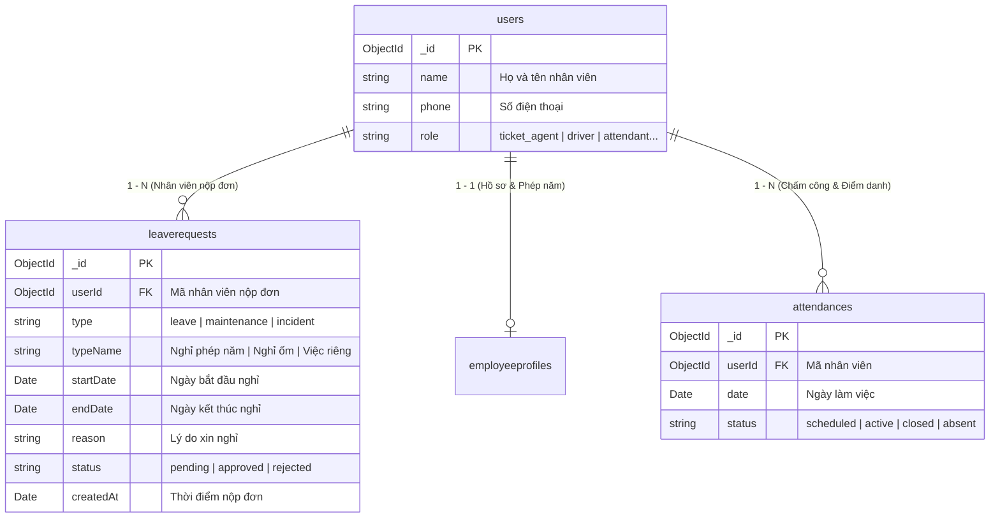

# TÀI LIỆU CHỨC NĂNG ĐƠN XIN NGHỈ PHÉP (MONGODB & HỆ THỐNG AN BÌNH LINES)

> **Mục đích:** Tài liệu giải thích chi tiết các bảng dữ liệu liên quan, cấu trúc Schema trong MongoDB và luồng nghiệp vụ của chức năng **Đơn Xin Nghỉ Phép** dành cho toàn bộ nhân sự nhà xe.

---

## 1. CÁC BẢNG (COLLECTIONS) TRONG MONGODB LIÊN QUAN

Chức năng **Đơn xin nghỉ phép** liên kết trực tiếp với **3 bảng cốt lõi** trong MongoDB:

---

## 2. BẢNG CHÍNH: `leaverequests` (Model `LeaveRequest.js`)

Đây là collection chính lưu trữ toàn bộ các đơn xin nghỉ phép của nhân viên (và cả các yêu cầu bảo dưỡng, sự cố kỹ thuật).

### Cấu trúc chi tiết các trường dữ liệu:

| Tên trường (Field) | Kiểu dữ liệu | Bắt buộc | Ý nghĩa nghiệp vụ |
| :--- | :--- | :---: | :--- |
| `_id` | `ObjectId` | Có | Khóa chính tự sinh của đơn. |
| `userId` | `ObjectId` | Có | **Khóa ngoại** tham chiếu sang `users._id` (xác định nhân viên nào nộp đơn). |
| `type` | `String` | Có | Loại đề xuất: `'leave'` (Nghỉ phép), `'maintenance'` (Bảo dưỡng), `'incident'` (Sự cố). Mặc định: `'leave'`. |
| `typeName` | `String` | Có | Tên phân loại nghỉ hiển thị:  • *Nghỉ phép năm (Hưởng nguyên lương)* • *Nghỉ ốm đau / Khám chữa bệnh* • *Việc riêng gia đình (Có phép)* • *Nghỉ không hưởng lương* |
| `startDate` | `Date` | Có | Ngày bắt đầu nghỉ phép (00:00:00). |
| `endDate` | `Date` | Có | Ngày kết thúc kỳ nghỉ phép (23:59:59). |
| `reason` | `String` | Có | Lý do cụ thể của nhân viên (tối thiểu 10 ký tự). |
| `status` | `String` | Có | Trạng thái xét duyệt: • `'pending'`: Đang chờ Quản lý duyệt. • `'approved'`: Quản lý đã phê duyệt. • `'rejected'`: Quản lý từ chối. |
| `details` | `String` | Không | Chuỗi tổng hợp tóm tắt (VD: *"Nghỉ từ 20/11 đến 22/11. Lý do: Nghỉ ốm"*). |
| `createdAt` | `Date` | Có | Ngày giờ nộp đơn lên hệ thống. |
| `updatedAt` | `Date` | Có | Ngày giờ cập nhật kết quả duyệt. |

---

## 3. CÁC BẢNG LIÊN QUAN VÀ MỐI QUAN HỆ NGHIỆP VỤ

### 3.1. Bảng `users` (Khóa ngoại 1 - N)
- **Mối liên hệ:** Đơn nghỉ phép chỉ lưu `userId`. Khi hiển thị danh sách đơn cho Cấp quản lý (`ops_manager`, `ticket_manager`, `general_manager`) duyệt, hệ thống dùng `.populate('userId', 'name phone role')` để lấy thông tin nhân sự.
- **Ý nghĩa:** Tránh lưu trùng lặp tên, SĐT trong đơn (chuẩn hóa 3NF). Khi nhân viên đổi số điện thoại, đơn xin nghỉ vẫn luôn đồng bộ chính xác.

### 3.2. Bảng `attendances` (Đồng bộ Ngày Chấm Công & Chuyên Cần)
- **Mối liên hệ:** Khi đơn nghỉ phép được chuyển sang trạng thái `'approved'`:
  - Trong ngày nghỉ đó, nhân sự **không bị đánh dấu là Vắng không phép (`absent`)**.
  - Hệ thống tính ngày nghỉ đó là **"Nghỉ phép có phép"**.
  - Tỷ lệ chuyên cần (Attendance Rate) trên trang **Bảng Lương (`StaffSalaryPage`)** và **Chấm Công (`StaffAttendancePage`)** vẫn được giữ trọn vẹn, không bị trừ thưởng chuyên cần hàng tháng.

### 3.3. Bảng `employeeprofiles` (Quản lý Quỹ Phép Năm)
- Lưu thông tin chi nhánh công tác (`branchId`), văn phòng làm việc (`assignedOffice`) để hệ thống biết đơn này cần chuyển tới người Quản lý chi nhánh nào phê duyệt.

---

## 4. QUY TRÌNH LUỒNG ĐI CỦA DỮ LIỆU (WORKFLOW)

1. **Bước 1 (Nhân viên nộp đơn):**  
   - Nhân viên truy cập trang **Đơn xin nghỉ** (`StaffLeavePage.js`).
   - Hệ thống tự động bắt lỗi nhập liệu (Validation):
     + *Từ ngày* không được ở quá khứ.
     + *Đến ngày* phải $\ge$ *Từ ngày*.
     + Tự động tính số ngày nghỉ đề xuất.
     + *Lý do nghỉ* bắt buộc tối thiểu 10 ký tự.
   - Gửi yêu cầu qua API: `POST /api/users/leave`.
   - Một bản ghi mới được thêm vào collection `leaverequests` với `status: 'pending'`.

2. **Bước 2 (Quản lý phê duyệt):**  
   - Cán bộ quản lý vào màn hình **Xét duyệt đơn nghỉ** (`ManagerLeavesPage.js` / `ManagerApprovalsPage.js`).
   - Quản lý nhấn **"Duyệt đơn"** (`approved`) hoặc **"Từ chối"** (`rejected`).
   - Cập nhật trạng thái vào `leaverequests`.

3. **Bước 3 (Đồng bộ tự động vào Bảng công & Lương):**  
   - Nếu duyệt (`approved`), hệ thống tự động ghi nhận ngày phép hợp lệ vào bảng lương và biểu đồ chấm công tháng của nhân viên.
