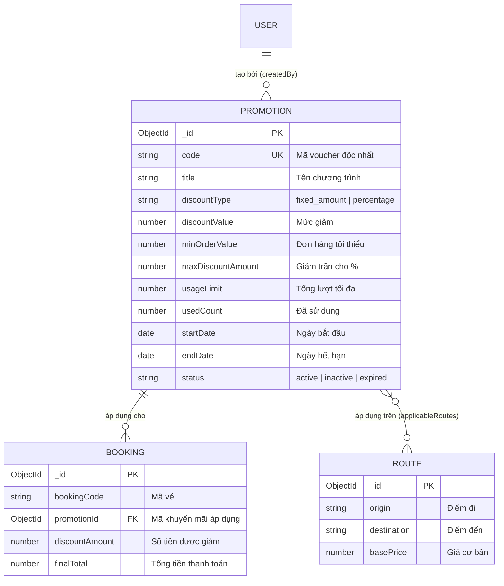

# BẢNG DỮ LIỆU CHỨC NĂNG QUẢN LÝ MÃ KHUYẾN MÃI (PROMOTIONS)
**Hệ thống Quản lý Nhà xe An Bỉnh Lines**  
*Tài liệu kỹ thuật cơ sở dữ liệu & Quy tắc bắt lỗi (Validation)*

---

## 1. TỔNG QUAN BẢNG DỮ LIỆU

- **Tên Collection (MongoDB):** `promotions`
- **Mongoose Model:** `Promotion` (định nghĩa tại file [backend/models/Promotion.js](file:///c:/Users/VanLoc/OneDrive%20-%20Industrial%20University%20of%20HoChiMinh%20City/Documents/KLTN/HeThongQuanLyNhaXe/backend/models/Promotion.js))
- **File Controller xử lý:** [backend/controllers/promotionController.js](file:///c:/Users/VanLoc/OneDrive%20-%20Industrial%20University%20of%20HoChiMinh%20City/Documents/KLTN/HeThongQuanLyNhaXe/backend/controllers/promotionController.js))
- **File Giao diện Quản trị (Admin):** [frontend/admin-dashboard/src/pages/gm/GmPromotionsPage.js](file:///c:/Users/VanLoc/OneDrive%20-%20Industrial%20University%20of%20HoChiMinh%20City/Documents/KLTN/HeThongQuanLyNhaXe/frontend/admin-dashboard/src/pages/gm/GmPromotionsPage.js))
- **Mục đích:** Quản lý toàn bộ danh sách mã giảm giá, voucher kích cầu, chiến dịch ưu đãi vé xe cho khách hàng đặt vé trực tuyến hoặc tại quầy của nhà xe An Bỉnh Lines.

---

## 2. BẢNG ĐẶC TẢ CHI TIẾT CÁC TRƯỜNG DỮ LIỆU (FIELDS SPECIFICATION)

| STT | Tên trường (Field Name) | Kiểu dữ liệu (Data Type) | Bắt buộc / Mặc định | Ý nghĩa & Mô tả chức năng | Ràng buộc nghiệp vụ & Bắt lỗi (Validation) |
|:---:|:---|:---:|:---:|:---|:---|
| **1** | `_id` | `ObjectId` | Tự sinh | Khóa chính định danh duy nhất cho từng bản ghi voucher trong MongoDB. | Tự động sinh bởi MongoDB. |
| **2** | `code` | `String` | **Bắt buộc** (Unique) | **Mã voucher** mà khách hàng nhập khi thanh toán (VD: `ANBINH2026`, `TET2026`, `VOUCHER50K`). | - Bắt buộc nhập, duy nhất toàn hệ thống (`unique`).<br>- Tự động chuyển thành chữ hoa (`uppercase`) và loại bỏ khoảng trắng thừa (`trim`).<br>- Định dạng: 3 đến 20 ký tự, viết liền không dấu, chỉ gồm chữ cái `A-Z`, số `0-9`, dấu gạch ngang `-` hoặc gạch dưới `_`. |
| **3** | `title` | `String` | **Bắt buộc** | **Tên chương trình khuyến mãi** (VD: *Chào Xuân 2026 - Giảm 50.000đ trực tiếp*). | - Bắt buộc nhập, tối thiểu 5 ký tự.<br>- Tối đa 200 ký tự, tự động cắt tỉa khoảng trắng. |
| **4** | `description` | `String` | Không bắt buộc (Default: `""`) | **Mô tả chi tiết** về thể lệ, đối tượng thụ hưởng và điều kiện áp dụng mã. | Văn bản tự do, hỗ trợ nhiều dòng. |
| **5** | `discountType` | `String (Enum)` | Mặc định: `fixed_amount` | **Loại hình giảm giá**:<br>- `fixed_amount`: Giảm số tiền cố định (VNĐ)<br>- `percentage`: Giảm theo tỷ lệ phần trăm (%) | Chỉ nhận 1 trong 2 giá trị hợp lệ: `['fixed_amount', 'percentage']`. |
| **6** | `discountValue` | `Number` | **Bắt buộc** | **Mức giảm giá**:<br>- Nếu loại là `percentage`: Tỷ lệ % (VD: 10, 15, 20)<br>- Nếu loại là `fixed_amount`: Số tiền VNĐ (VD: 50.000, 100.000) | - Bắt buộc nhập, phải là số lớn hơn 0.<br>- Nếu `%`: Nằm trong khoảng từ `1%` đến `100%`.<br>- Nếu tiền cố định: Tối thiểu `1.000 VNĐ`. Không được lớn hơn giá trị đơn hàng tối thiểu (`minOrderValue`). |
| **7** | `minOrderValue` | `Number` | Mặc định: `0` | **Giá trị đơn hàng tối thiểu** để áp dụng mã (VNĐ). Khách mua vé có tổng tiền từ mức này trở lên mới dùng được mã. | - Phải là số `>= 0`.<br>- `0` nghĩa là áp dụng cho mọi giá trị đơn hàng.<br>- Phải lớn hơn hoặc bằng `discountValue` nếu loại giảm giá là tiền cố định. |
| **8** | `maxDiscountAmount` | `Number` | Mặc định: `0` | **Mức giảm tối đa** (VNĐ) khi áp dụng giảm theo tỷ lệ `%` (tránh đơn vé quá lớn bị trừ quá nhiều tiền). | - Phải là số `>= 0`.<br>- `0` nghĩa là không giới hạn số tiền giảm trần.<br>- Chỉ áp dụng khi `discountType === 'percentage'`, bị vô hiệu hóa khi loại là tiền cố định. |
| **9** | `usageLimit` | `Number` | Mặc định: `100` | **Tổng số lượt sử dụng tối đa** của mã khuyến mãi trên toàn hệ thống. | - Bắt buộc nhập, phải là số nguyên dương `>= 1`.<br>- Khi sửa mã, không được đặt nhỏ hơn số lượt đã sử dụng (`usedCount`). |
| **10** | `usedCount` | `Number` | Mặc định: `0` | **Số lượt mã đã được khách hàng sử dụng thực tế** thành công. | - Số nguyên `>= 0`.<br>- Hệ thống tự động tăng 1 mỗi khi có đơn đặt vé thanh toán thành công áp dụng mã này. |
| **11** | `startDate` | `Date` | **Bắt buộc** | **Ngày và giờ bắt đầu** có hiệu lực của mã khuyến mãi. | - Bắt buộc chọn ngày hợp lệ.<br>- Không được sau ngày kết thúc (`endDate`). |
| **12** | `endDate` | `Date` | **Bắt buộc** | **Ngày và giờ hết hạn** của mã khuyến mãi. | - Bắt buộc chọn ngày hợp lệ.<br>- Phải sau hoặc cùng ngày với ngày bắt đầu (`endDate >= startDate`). |
| **13** | `status` | `String (Enum)` | Mặc định: `active` | **Trạng thái hoạt động** của mã:<br>- `active`: Đang hoạt động (khách dùng được)<br>- `inactive`: Tạm dừng áp dụng<br>- `expired`: Đã hết hạn sử dụng | Nhận 1 trong 3 giá trị: `['active', 'inactive', 'expired']`. |
| **14** | `applicableRoutes` | `Array<ObjectId>` | Không bắt buộc (Default: `[]`) | Danh sách các tuyến đường cụ thể được áp dụng mã (tham chiếu tới bảng `routes`). | Mảng các ID `Route`. Nếu mảng rỗng thì áp dụng cho **toàn bộ các tuyến đường**. |
| **15** | `createdBy` | `String` | Mặc định: `Ban Giám Đốc` | Người tạo hoặc ban hành chương trình ưu đãi (ghi nhận tên hoặc email tài khoản thực hiện). | Tự động gán từ thông tin phiên đăng nhập của Quản trị viên/Ban Giám Đốc. |
| **16** | `createdAt` | `Date` | Tự sinh | Thời điểm tạo bản ghi. | Mongoose `timestamps: true`. |
| **17** | `updatedAt` | `Date` | Tự sinh | Thời điểm cập nhật bản ghi lần cuối cùng. | Mongoose `timestamps: true`. |

---

## 3. CHI TIẾT CÁC QUY TẮC BẮT LỖI (VALIDATION RULES)

Hệ thống triển khai cơ chế **xác thực kép (Dual-layer Validation)** tại cả Client (Frontend React) và Server (Node.js/Express Backend) để bảo đảm tính toàn vẹn dữ liệu:

### 3.1. Bắt lỗi Mã Voucher (`code`)
- **Lỗi bỏ trống:** Báo *"Vui lòng nhập mã voucher"*.
- **Lỗi ký tự không hợp lệ / sai độ dài:** Báo *"Mã voucher phải từ 3 đến 20 ký tự, viết liền không dấu, chỉ gồm chữ cái A-Z, chữ số 0-9, dấu gạch nối (-) hoặc gạch dưới (_)"*.
- **Lỗi trùng lặp (Duplicate Code):** Khi gửi lên máy chủ, nếu mã đã tồn tại ở bản ghi khác sẽ báo lỗi: *"Mã khuyến mãi '[CODE]' đã tồn tại trên hệ thống"*.

### 3.2. Bắt lỗi Tên chương trình (`title`)
- **Lỗi bỏ trống:** Báo *"Vui lòng nhập tên chương trình khuyến mãi"*.
- **Lỗi quá ngắn:** Báo *"Tên chương trình khuyến mãi phải có ít nhất 5 ký tự"*.

### 3.3. Bắt lỗi Mức giảm giá (`discountValue`) & Loại giảm giá (`discountType`)
- **Lỗi không nhập hoặc `<= 0`:** Báo *"Mức giảm giá phải là số dương lớn hơn 0"*.
- **Trường hợp Giảm theo tỷ lệ % (`percentage`):**
  - Mức giảm phải từ `1%` đến `100%`. Nếu nhập ngoài khoảng này sẽ báo: *"Tỷ lệ giảm giá (%) phải nằm trong khoảng từ 1% đến 100%"*.
- **Trường hợp Giảm tiền cố định (`fixed_amount`):**
  - Mức giảm tối thiểu là `1.000 VNĐ`. Nếu nhập nhỏ hơn sẽ báo: *"Mức giảm tiền cố định tối thiểu là 1.000 VNĐ"*.
  - Nếu có nhập *Đơn hàng tối thiểu (`minOrderValue`)*, mức giảm không được vượt quá đơn hàng tối thiểu. Nếu vượt quá sẽ báo: *"Mức giảm ([X]đ) không được vượt quá đơn hàng tối thiểu ([Y]đ)"*.

### 3.4. Bắt lỗi Đơn hàng tối thiểu (`minOrderValue`) & Giảm tối đa (`maxDiscountAmount`)
- Số tiền nhập vào không được là số âm (`< 0`).
- Nếu loại giảm giá là tiền cố định, trường *Giảm tối đa (`maxDiscountAmount`)* sẽ tự động vô hiệu hóa (`disabled`) và lưu về giá trị `0`.

### 3.5. Bắt lỗi Giới hạn lượt dùng (`usageLimit`)
- **Lỗi bỏ trống:** Báo *"Vui lòng nhập giới hạn lượt dùng"*.
- **Lỗi giá trị:** Phải là số nguyên dương `>= 1`.
- **Khi chỉnh sửa mã:** Giới hạn mới không được nhỏ hơn số lượt mã đã được khách sử dụng trong thực tế (`usageLimit >= usedCount`).

### 3.6. Bắt lỗi Thời gian áp dụng (`startDate`, `endDate`)
- Cả hai trường ngày bắt đầu và ngày kết thúc đều là bắt buộc.
- Ngày kết thúc phải diễn ra cùng ngày hoặc sau ngày bắt đầu (`endDate >= startDate`). Nếu vi phạm báo: *"Ngày kết thúc phải diễn ra sau hoặc cùng ngày với ngày bắt đầu"*.

---

## 4. MỐI QUAN HỆ DỮ LIỆU (DATABASE RELATIONSHIPS)



---

## 5. VÍ DỤ BẢN GHI DỮ LIỆU THỰC TẾ (SAMPLE JSON DOCUMENT)

```json
{
  "_id": "67451a8f9021bc34e0019a12",
  "code": "ANBINH2026",
  "title": "Chào Xuân 2026 - Giảm 50.000đ trực tiếp",
  "description": "Áp dụng cho mọi đơn đặt vé từ 200.000đ trở lên nhân dịp Tết Nguyên Đán 2026",
  "discountType": "fixed_amount",
  "discountValue": 50000,
  "maxDiscountAmount": 0,
  "minOrderValue": 200000,
  "usageLimit": 100,
  "usedCount": 14,
  "startDate": "2026-11-26T00:00:00.000Z",
  "endDate": "2026-12-31T23:59:59.000Z",
  "status": "active",
  "applicableRoutes": [],
  "createdBy": "Nguyễn An Bình (Ban Giám Đốc)",
  "createdAt": "2026-11-26T05:15:00.000Z",
  "updatedAt": "2026-11-26T05:15:00.000Z"
}
```
