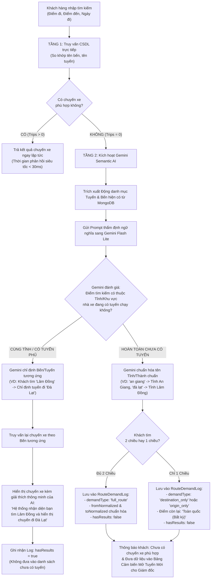

# KẾ HOẠCH THIẾT KẾ & TRIỂN KHAI: HỆ THỐNG CẢM BIẾN NHU CẦU MỞ TUYẾN & TÌM KIẾM ĐỊA LÝ THÔNG MINH BẰNG GOOGLE GEMINI AI (ZERO-HARDCODE)

**Dự án:** Hệ thống Quản trị & Điều hành Nhà xe An Bình Lines  
**Phân hệ:** Cảm biến Nhu cầu Mở Tuyến (Demand Sensing) & Tìm kiếm Chuyến xe Thông minh (Semantic Trip Search)  
**Tác giả:** Đội ngũ Kỹ thuật Hệ thống  
**Ngày lập kế hoạch:** 26/11/2026  

---

## 1. MỤC TIÊU & NGUYÊN TẮC CỐT LÕI

### 1.1. Thực trạng & Hạn chế của giải pháp cũ
1. **Bị "công nghiệp" do lưu trữ tĩnh (Hardcode Dictionary):** Việc khai báo các mảng địa danh cố định như `GEO_REGIONS` (danh sách tỉnh, các từ khóa con "bảo lộc", "di linh", "châu đốc"...) khiến mã nguồn cồng kềnh, khó bảo trì và không thích ứng được khi người dùng tìm kiếm các thắng cảnh tự do, địa danh mới hoặc các địa danh thuộc 63 tỉnh thành Việt Nam.
2. **Khách tìm theo Tỉnh nhưng nhà xe ghi bến theo Thành phố:** Khi khách tìm kiếm *"TP. Hồ Chí Minh ➔ Lâm Đồng"*, nhà xe có tuyến *"Hồ Chí Minh ➔ Đà Lạt"* (toàn bộ điểm trả khách nằm trong tỉnh Lâm Đồng). Tuy nhiên bộ lọc cũ chỉ so khớp chuỗi chữ chính xác với bến đến nên báo "0 chuyến", làm mất khách và ghi nhầm vào danh sách nhu cầu chưa có tuyến.
3. **Dữ liệu nhu cầu bị phân mảnh (Chưa gom cụm ngữ nghĩa):** Khách tìm *"an giang ➔ đà lạt"* và *"An Giang ➔ Lâm Đồng"* bị lưu thành 2 dòng riêng biệt (8 lượt và 3 lượt), thay vì hiểu rằng cả hai đều có chung nhu cầu đi từ tỉnh An Giang đến tỉnh Lâm Đồng (Đà Lạt).
4. **Chưa có cơ chế xử lý rõ ràng khi khách chỉ tìm 1 chiều:** Khi khách chỉ nhập Điểm đến (VD: chỉ tìm *"Lâm Đồng"*, *"Quy Nhơn"*) hoặc chỉ nhập Điểm đi (VD: chỉ tìm *"An Giang"*), hệ thống chưa có quy chuẩn lưu vết và phân tích nhu cầu đơn lẻ này cho Ban Giám đốc.

### 1.2. Nguyên tắc thiết kế mới (100% Zero-Hardcode & AI-Driven)
1. **Tri thức Địa lý 100% từ Gemini AI:** Tuyệt đối không lưu mảng danh sách tỉnh thành/địa danh tĩnh trong code. Mọi tri thức địa lý (thắng cảnh, xã/huyện thuộc tỉnh nào, các thành phố cùng chung một tỉnh) đều do **Google Gemini AI Flash Lite** phân tích và phân giải theo thời gian thực.
2. **Truy vấn Mạng lưới Tuyến xe Động từ CSDL (Dynamic Network Context):** Danh sách các tuyến xe, bến đi, bến đến và các trạm đón/trả thực tế của nhà xe được truy vấn trực tiếp từ MongoDB (`Route` và `Trip`) để làm ngữ cảnh cung cấp cho Gemini AI. Khi nhà xe thêm bến hoặc mở tuyến mới trên trang quản trị, AI tự động nhận biết ngay lập tức mà không cần sửa code.
3. **Tìm kiếm 2 Tầng Hiệu năng Cao (Two-Tier Search Pipeline):**
   - *Tầng 1 (Direct DB Search):* Tìm kiếm trực tiếp siêu nhanh trong CSDL (< 30ms). Nếu khách gõ đúng bến/tuyến (VD: "Hồ Chí Minh" ➔ "Đà Lạt"), hệ thống trả kết quả ngay.
   - *Tầng 2 (Gemini Semantic Matching):* Chỉ kích hoạt khi Tầng 1 trả về 0 kết quả. Gemini sẽ phân tích xem điểm khách gõ có nằm trong cùng tỉnh hoặc tương đương với điểm đón/trả của tuyến nào nhà xe đang có không.
4. **Phân tách Rõ ràng 2 Loại Nhu cầu trong Cảm biến Dữ liệu (`RouteDemandLog`):**
   - *Nhu cầu Chặng Hoàn Chỉnh (Full Route Corridor):* Khách tìm đủ cả Điểm đi và Điểm đến $\rightarrow$ Phục vụ kế hoạch mở tuyến xe mới kết nối giữa 2 địa phương.
   - *Nhu cầu Điểm Nóng 1 Chiều (Single Endpoint Demand):* Khách chỉ tìm Điểm đến hoặc Điểm đi $\rightarrow$ Phục vụ phân tích thị trường điểm đến "hot" để nghiên cứu mở tour hoặc kết nối từ các trạm trung tâm.

---

## 2. QUY TRÌNH TÌM KIẾM CHUYẾN XE THÔNG MINH (SEMANTIC SEARCH PIPELINE)

### 2.1. Sơ đồ luồng xử lý (Mermaid Workflow)



---

### 2.2. Chi tiết Cơ chế Đối soát Ngữ nghĩa Động của Gemini AI (Tầng 2)

Khi Tầng 1 không tìm thấy chuyến, hệ thống gửi sang Gemini AI một payload gồm:
1. `searchQuery`: Điểm đi (`from`) và Điểm đến (`to`) do người dùng nhập.
2. `availableNetwork`: Mảng động trích xuất trực tiếp từ các tuyến xe đang hoạt động:
   ```json
   [
     {
       "routeName": "Hồ Chí Minh ➔ Đà Lạt",
       "startPoint": "Hồ Chí Minh",
       "endPoint": "Đà Lạt",
       "stops": ["Bến Xe Miền Tây", "Lê Hồng Phong", "Bảo Lộc", "Di Linh", "Đức Trọng", "Bến Xe Liên Tỉnh Đà Lạt"],
       "addresses": ["TP.HCM", "Đồng Nai", "Tỉnh Lâm Đồng"]
     },
     {
       "routeName": "Hồ Chí Minh ➔ Cần Thơ",
       "startPoint": "Hồ Chí Minh",
       "endPoint": "Cần Thơ",
       "stops": ["Bến Xe Miền Tây", "Cai Lậy", "Cái Bè", "Bình Minh", "Bến Xe Trung Tâm Cần Thơ"],
       "addresses": ["TP.HCM", "Tiền Giang", "Vĩnh Long", "TP. Cần Thơ"]
     }
   ]
   ```
3. **Nhiệm vụ của Gemini AI:**
   - Xác định điểm đi và điểm đến của người dùng thuộc Tỉnh/Thành phố nào của Việt Nam.
   - So sánh với mạng lưới `availableNetwork` của nhà xe:
     - Nếu Điểm đến của khách là *"Lâm Đồng"* hoặc *"Chợ Đà Lạt"* hoặc *"Bảo Lộc"* $\rightarrow$ Gemini đối chiếu thấy tỉnh Lâm Đồng nằm trong tuyến *"Hồ Chí Minh ➔ Đà Lạt"* $\rightarrow$ Trả về `matchedRoute`: `"Hồ Chí Minh ➔ Đà Lạt"`, `suggestedEndpoint`: `"Đà Lạt"`, `isCovered`: `true`.
     - Nếu Điểm đến của khách là *"An Giang"* hoặc *"Rạch Giá"* $\rightarrow$ Gemini đối chiếu thấy nhà xe chưa có tuyến nào tới An Giang $\rightarrow$ Trả về `isCovered`: `false`, `normalizedFrom`: `"Tỉnh An Giang"`, `normalizedTo`: `"Tỉnh Lâm Đồng (Đà Lạt)"`.

---

## 3. THIẾT KẾ DỮ LIỆU & XỬ LÝ KHI TÌM KIẾM 1 CHIỀU VÀ 2 CHIỀU

Người dùng tìm kiếm trên hệ thống thường xảy ra các trường hợp nhập liệu khác nhau. Hệ thống sẽ phân loại và lưu vết vào `RouteDemandLog` theo thiết kế sau:

### 3.1. Cấu trúc Mở rộng của Collection `RouteDemandLog`

```javascript
const routeDemandLogSchema = new mongoose.Schema({
  // Chuỗi người dùng gõ thực tế
  fromRaw: { type: String, default: '' },
  toRaw: { type: String, default: '' },

  // Nhãn Tỉnh/Thành chuẩn hóa do Gemini AI nhận diện (Không phụ thuộc từ điển cứng)
  fromNormalized: { type: String, default: 'Toàn quốc' },
  toNormalized: { type: String, default: 'Toàn quốc' },
  
  // Tỉnh/Thành và Vùng miền do Gemini trích xuất
  fromProvince: { type: String, default: '' },
  toProvince: { type: String, default: '' },
  regionCluster: { type: String, default: '' }, // VD: "An Giang ➔ Lâm Đồng"

  // Phân loại hình thức tìm kiếm
  demandType: {
    type: String,
    enum: [
      'full_route',        // Tìm đủ 2 chiều (Có cả Điểm đi và Điểm đến)
      'destination_only',   // Chỉ tìm 1 chiều: Điểm đến (Bỏ trống điểm đi)
      'origin_only'        // Chỉ tìm 1 chiều: Điểm đi (Bỏ trống điểm đến)
    ],
    default: 'full_route'
  },

  // Số lượng khách & Ngày tìm kiếm
  passengers: { type: Number, default: 1 },
  searchDate: { type: String, default: '' },
  tripResultsCount: { type: Number, default: 0 },
  hasResults: { type: Boolean, default: false },

  // Cờ nhận diện tuyến có trong hệ thống không
  isRouteExistingInSystem: { type: Boolean, default: false },

  // Thiết bị & Thời gian
  deviceType: { type: String, default: 'desktop' },
  createdAt: { type: Date, default: Date.now, index: true }
});
```

---

### 3.2. Bảng phân tích chi tiết xử lý 3 trường hợp tìm kiếm:

| Trường hợp | Thao tác của khách hàng | Cách Gemini AI xử lý | Dữ liệu lưu vào `RouteDemandLog` | Ứng dụng quản trị cho Giám Đốc |
| :--- | :--- | :--- | :--- | :--- |
| **1. Cặp chặng Đủ 2 Chiều** | Khách nhập Điểm đi: *"an giang"*, Điểm đến: *"đà lạt"* (hoặc *"An Giang" ➔ "Lâm Đồng"*) | Gemini nhận diện An Giang thuộc Tỉnh An Giang; Đà Lạt thuộc Tỉnh Lâm Đồng. Cả 2 đều quy về cặp: **An Giang ➔ Lâm Đồng (Đà Lạt)** | - `demandType`: `full_route`<br>- `fromNormalized`: `"An Giang"`<br>- `toNormalized`: `"Lâm Đồng (Đà Lạt)"`<br>- `hasResults`: `false` | Hiển thị trong **Bảng Nhu cầu Mở Tuyến Mới**. Giúp Giám đốc quyết định mở tuyến xe kết nối giữa 2 tỉnh (VD: Tuyến An Giang - Đà Lạt 11 lượt tìm). |
| **2. Chỉ tìm Điểm Đến (1 chiều)** | Khách bỏ trống Điểm đi, chỉ nhập Điểm đến: *"Lâm Đồng"* hoặc *"Quy Nhơn"* | - Nếu là *"Lâm Đồng"*: Gemini nhận diện có tuyến đi Đà Lạt $\rightarrow$ hiển thị chuyến Đà Lạt, `hasResults: true`.<br>- Nếu là *"Quy Nhơn"*: Gemini xác định thuộc Tỉnh Bình Định, nhà xe chưa có chuyến $\rightarrow$ ghi nhận nhu cầu điểm đến mới. | - `demandType`: `destination_only`<br>- `fromNormalized`: `"Toàn quốc (Bất kỳ)"`<br>- `toNormalized`: `"Bình Định (Quy Nhơn)"`<br>- `hasResults`: `false` | Thống kê vào bảng **"Điểm Đến Được Quan Tâm Nhất (Top Wanted Destinations)"**. Giúp Giám đốc biết tỉnh nào đang có nhu cầu du lịch cao để mở tuyến xuất phát từ các trạm đầu não (Sài Gòn / Cần Thơ). |
| **3. Chỉ tìm Điểm Đi (1 chiều)** | Khách chỉ nhập Điểm đi: *"Bến Tre"* hoặc *"Cà Mau"*, bỏ trống Điểm đến | Gemini nhận diện Bến Tre thuộc Tỉnh Bến Tre; kiểm tra nhà xe chưa có trạm/bến nào tại Bến Tre. | - `demandType`: `origin_only`<br>- `fromNormalized`: `"Bến Tre"`<br>- `toNormalized`: `"Toàn quốc (Bất kỳ)"`<br>- `hasResults`: `false` | Thống kê vào mục **"Cửa Ngõ Xuất Phát Mới (Origin Gateways)"**. Giúp Giám đốc biết tại địa phương nào có nhiều khách hàng muốn đi xe An Bình Lines để cân nhắc đặt thêm Trạm đón/Văn phòng chi nhánh. |

---

## 4. THIẾT KẾ BÁO CÁO & TRỰC QUAN HÓA CHO BAN GIÁM ĐỐC (`GmAnalysisPage.js`)

Để Ban Giám Đốc nắm bắt thông tin rõ ràng, không bị lẫn lộn giữa nhu cầu chặng 2 chiều và nhu cầu 1 chiều, giao diện Tab *"Nhu cầu Mở Tuyến Mới"* sẽ được phân bổ thành 2 phần:

### 4.1. Khối 1: Bảng Xếp Hạng Tuyến Mới Cần Mở (Chặng 2 Chiều - `demandType: 'full_route'`)
- **Nội dung:** Gom cụm thông minh bằng nhãn AI (VD: Toàn bộ lượt tìm *an giang -> đà lạt* và *An Giang -> Lâm Đồng* tự động gộp thành 1 dòng: `An Giang ➔ Lâm Đồng (Đà Lạt)` với tổng 11 lượt tìm).
- **Bộ lọc an toàn:** Tuyệt đối loại trừ các chặng mà nhà xe đã có tuyến hoạt động (như *TP. Hồ Chí Minh ➔ Lâm Đồng* sẽ không xuất hiện tại đây vì đã có tuyến *Hồ Chí Minh ➔ Đà Lạt* chạy mỗi ngày).
- **Cột Đề xuất Hành động AI:** Gemini AI phân tích cự ly, lưu lượng và đưa ra đề xuất cụ thể (chạy thử nghiệm cuối tuần, dòng xe phù hợp).

### 4.2. Khối 2: Thống Kê Điểm Đến & Điểm Đi Tiềm Năng (Nhu cầu 1 Chiều - `destination_only` & `origin_only`)
- Hiển thị danh sách top 5 Tỉnh/Thành phố được khách hàng tìm kiếm nhiều nhất nhưng nhà xe chưa có chuyến (Ví dụ: Tỉnh Bình Định: 15 lượt tìm kiếm; Tỉnh Bến Tre: 9 lượt tìm kiếm).
- Đưa ra nhận định xu hướng: Giúp Giám đốc nhìn thấy bức tranh tổng thể về các địa phương đang có sức hút vận tải lớn.

### 4.3. Nâng cấp Chatbot Trợ Lý Cố Vấn AI
- Cung cấp ngữ cảnh đã gom cụm cho Gemini Executive Chatbot:
  + Khi Giám đốc hỏi: *"Nên mở tuyến nào dựa trên tìm kiếm khách hàng?"*
  + Chatbot AI sẽ trả lời mạch lạc:
    > *"Dạ thưa Giám đốc, qua phân tích dữ liệu tìm kiếm thực tế của hành khách (hệ thống đã tự động gom cụm các địa danh cùng tỉnh thành):*
    > *• Về cặp chặng cụ thể: Tuyến **An Giang ➔ Lâm Đồng (Đà Lạt)** đang dẫn đầu với 11 lượt tìm kiếm (gộp từ các tìm kiếm đi Đà Lạt và Lâm Đồng). Đề xuất Giám đốc xem xét mở tuyến thử nghiệm xe Giường nằm chạy vào dịp cuối tuần.*
    > *• Về điểm đến 1 chiều: Khách hàng cũng đang quan tâm nhiều đến khu vực Bình Định và Bến Tre..."*

---

## 5. KẾ HOẠCH BỐ CỤC MÃ NGUỒN & CÁC BƯỚC TRIỂN KHAI

### Bước 1: Xóa bỏ hoàn toàn mảng tĩnh trong `geoCluster.js`
- Xóa mảng hardcode `GEO_REGIONS = [...]`.
- Thay thế bằng hàm tiện ích AI: `geminiService.resolveSemanticLocationAndRouteMatch(queryText, availableRoutes)` giao toàn quyền thẩm định địa danh và liên kết tỉnh thành cho Google Gemini AI Flash Lite.

### Bước 2: Nâng cấp `tripService.js` và `tripController.js`
- Trong `searchTrips`:
  - Thực hiện tìm kiếm CSDL trực tiếp (Tầng 1).
  - Nếu kết quả = 0: Gọi Gemini phân giải ngữ nghĩa và kiểm tra độ phủ tuyến của nhà xe (Tầng 2).
  - Nếu Gemini tìm ra bến tương ứng cùng tỉnh $\rightarrow$ Lấy chuyến xe trả về ngay cho khách kèm thông điệp nhận diện thông minh, đánh dấu `hasResults = true`.
  - Nếu Gemini xác nhận chưa có tuyến $\rightarrow$ Chuẩn hóa tên tỉnh thành và ghi nhận `RouteDemandLog` với đúng loại `demandType` (`full_route`, `destination_only`, `origin_only`).

### Bước 3: Nâng cấp `pricingController.js` (`getUnmetDemandAnalytics`)
- Khi tổng hợp dữ liệu nhu cầu mở tuyến:
  - Tự động gom cụm các bản ghi theo nhãn Tỉnh/Thành chuẩn do AI nhận diện.
  - Tự động lọc bỏ bất kỳ chặng nào đã được mạng lưới tuyến của nhà xe phục vụ.
  - Phân tách dữ liệu trả về gồm danh sách chặng 2 chiều (`fullRoutes`) và danh sách điểm đến/điểm đi 1 chiều (`singleEndpoints`).

### Bước 4: Kiểm thử toàn diện các Kịch bản Thực tế
1. *Kịch bản 1:* Khách tìm kiếm *"TP. Hồ Chí Minh"* đi *"Lâm Đồng"* $\rightarrow$ Hệ thống tự động trả về 2 chuyến đi Đà Lạt (Lâm Đồng), không lưu vào danh sách chưa có tuyến.
2. *Kịch bản 2:* Khách tìm kiếm *"An Giang"* đi *"Đà Lạt"* và khách khác tìm *"an giang"* đi *"Lâm Đồng"* $\rightarrow$ Bảng phân tích tự động gom thành 1 dòng duy nhất *"An Giang ➔ Lâm Đồng (Đà Lạt)"* với tổng 11 lượt tìm kiếm.
3. *Kịch bản 3:* Khách chỉ tìm kiếm điểm đến *"Bình Định"* $\rightarrow$ Hệ thống lưu vào mục nhu cầu điểm đến 1 chiều và hiển thị ở bảng thống kê điểm đến tiềm năng.
4. *Kịch bản 4:* Chatbot Cố vấn AI trả lời đúng trọng tâm dựa trên dữ liệu đã gom cụm, không dùng văn mẫu rập khuôn.

---

> **Ban Giám Đốc vui lòng duyệt bản Kế hoạch thiết kế này. Sau khi bạn đồng ý, tôi sẽ bắt đầu triển khai code chi tiết theo từng bước đã nêu.**
