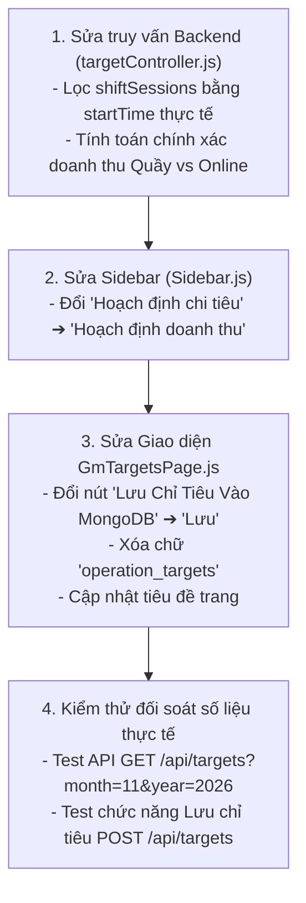

# KẾ HOẠCH & THIẾT KẾ: HOẠCH ĐỊNH DOANH THU CHI NHÁNH
**Hệ thống Quản lý và Điều hành Nhà xe An Bình Lines**  
*Tài liệu phục vụ Nghiên cứu, Báo cáo Khóa luận Tốt nghiệp & Chuẩn hóa Hệ thống*

---

## 1. GIẢI ĐÁP CÂU HỎI NGHIỆP VỤ: NÊN GHI "HOẠCH ĐỊNH DOANH THU" HAY "HOẠCH ĐỊNH CHI TIÊU"?

### 1.1. Phân biệt bản chất kế toán & quản trị vận tải:
- **"Hoạch định chi tiêu" (Expense / Spending Budgeting):**  
  Là kế hoạch **tiêu tiền ra** của doanh nghiệp, bao gồm: chi phí dầu máy, phí cầu đường bến bãi, chi phí sửa chữa bảo trì định kỳ phương tiện, lương phụ cấp tài xế và nhân viên.
- **"Hoạch định doanh thu" (Revenue Target Planning / Revenue Budgeting):**  
  Là kế hoạch **thu tiền vào** từ hoạt động kinh doanh vận tải, bao gồm: giao chỉ tiêu doanh số bán vé cho từng chi nhánh (TP.HCM, Đà Lạt, Cần Thơ), phân bổ tỷ trọng bán vé tại quầy (Counter) vs trực tuyến (Online), theo dõi tỷ lệ lấp đầy ghế và tiến độ hoàn thành doanh số thực tế so với mục tiêu.

### 1.2. Nguồn gốc của sự nhầm lẫn hiện tại:
- Trên màn hình của Giám đốc hiện tại hiển thị:
  - *"MỤC TIÊU DOANH THU (1.000.000.000 đ)"*
  - *"DOANH THU TẠI QUẦY (CHI NHÁNH)"*
  - *"DOANH THU TRỰC TUYẾN (ONLINE)"*
  - *"TỶ LỆ LẤP ĐẦY GHẾ"*
  - *"TIẾN ĐỘ (%) & ĐÁNH GIÁ ĐẠT CHỈ TIÊU"*
- Như vậy, **100% bản chất của chức năng này là Quản trị Doanh thu và Giao chỉ tiêu doanh số (KPI)**.
- Từ *"chi tiêu"* trên thanh menu Sidebar xuất hiện là do **lỗi nhầm lẫn chữ ký hiệu giữa "Chỉ tiêu" (Target / KPI) và "Chi tiêu" (Spending / Expense)** của lập trình viên trước đây.

> [!IMPORTANT]
> **KẾT LUẬN & ĐỀ XUẤT CHUẨN:**
> - Menu Sidebar: Đổi thành **"Hoạch định doanh thu"** (hoặc **"Chỉ tiêu doanh thu"**). Tuyệt đối **KHÔNG GHI "Hoạch định chi tiêu"**.
> - Tiêu đề trang: Đổi thành **"Hoạch Định Doanh Thu Chi Nhánh"**.

---

## 2. CÁC BẢNG (COLLECTIONS) TRONG MONGODB LIÊN QUAN ĐẾN CHỨC NĂNG NÀY

Hệ thống kết hợp dữ liệu từ **6 Collections thực tế** trong CSDL MongoDB `bus_management`:

| STT | Tên Collection | Vai trò và Dữ liệu trích xuất |
|:---:|:---|:---|
| 1 | **`operationaltargets`** | **Bảng Lưu trữ Mục tiêu do Giám đốc thiết lập:**<br>- `month`, `year`: Kỳ hoạt động (Tháng, Năm).<br>- `revenueTarget`: Mục tiêu tổng doanh thu tháng (VD: 1 tỷ VNĐ).<br>- `occupancyTarget`: Mục tiêu tỷ lệ lấp đầy ghế (VD: 80%).<br>- `counterTarget`: Chỉ tiêu bán tại phòng vé (VD: 600 triệu).<br>- `onlineTarget`: Chỉ tiêu bán qua Website/App (VD: 400 triệu).<br>- `branchTargets`: Phân bổ chỉ tiêu cho từng chi nhánh (`sg`: 500tr, `dl`: 300tr, `ct`: 200tr).<br>- `notes`: Ghi chú chỉ đạo của Ban Giám đốc. |
| 2 | **`shiftsessions`** | **Bảng Ca trực Phòng vé thực tế (Nguồn Doanh thu Quầy):**<br>- Trích xuất doanh thu tiền mặt (`cashRevenue`) và chuyển khoản quầy (`cashlessRevenue`) của các ca trực có `startTime` nằm trong tháng.<br>- Thống kê số lượng vé bán tại quầy (`ticketsSold`).<br>- Đánh giá hiệu suất làm việc của từng nhân viên bán vé (`userId`). |
| 3 | **`bookings`** | **Bảng Đơn đặt vé thực tế (Nguồn Doanh thu Online & Khách hàng):**<br>- Lọc các đơn vé thanh toán thành công (`status: ['paid', 'confirmed']`) trong tháng.<br>- Tách bạch doanh thu vé trực tuyến (Website/App) theo từng chi nhánh xuất phát của chuyến xe. |
| 4 | **`trips`** | **Bảng Chuyến xe Vận hành trong tháng:**<br>- Lọc các chuyến xe có thời gian xuất bến (`departureTime`) nằm trong tháng của từng chi nhánh.<br>- Thống kê tổng số ghế đã bán (`bookedSeats`) và tổng sức chứa tối đa (`capacity` hoặc `busId.totalSeats`) để tính **Tỷ lệ lấp đầy ghế thực tế**. |
| 5 | **`routes`** | **Bảng Tuyến đường:**<br>- Xác định tuyến xe trực thuộc chi nhánh nào quản lý thông qua bến xuất phát (`startPoint` thuộc TP. Hồ Chí Minh, Đà Lạt hay Cần Thơ). |
| 6 | **`users`** | **Bảng Nhân sự Chi nhánh:**<br>- Lấy danh sách Quản lý phòng vé (`ticket_manager`) và Nhân viên bán vé (`ticket_agent`) theo từng mã chi nhánh (`branch.branchId`). |

---

## 3. NGUYÊN NHÂN SỐ LIỆU DOANH THU ẢO (7,6 TỶ ĐỒNG) & PHƯƠNG ÁN LẤY DỮ LIỆU THẬT

### 3.1. Phân tích lỗi kỹ thuật hiện tại:
Trong file [backend/controllers/targetController.js](file:///c:/Users/VanLoc/OneDrive%20-%20Industrial%20University%20of%20HoChiMinh%20City/Documents/KLTN/HeThongQuanLyNhaXe/backend/controllers/targetController.js) (dòng 91-95):
```javascript
// TRUY VẤN LỖI HIỆN TẠI:
const shiftSessions = await ShiftSession.find({
  $or: [
    { startTime: { $gte: startDate, $lte: endDate } },
    { createdAt: { $gte: startDate, $lte: endDate } } // <- LỖI NẰM Ở ĐÂY
  ]
});
```
- Khi cơ sở dữ liệu được nạp (seed) vào tháng 11/2026, toàn bộ **1.044 ca trực** của các tháng 8, 9, 10 và 11 đều có trường `createdAt` rơi vào tháng 11.
- Điều kiện `$or: [{ createdAt: ... }]` đã gom toàn bộ ca trực của cả 4 tháng dồn hết vào tháng 11, khiến doanh thu quầy bị đội lên thành **7.477.890.000 đ** (gấp 7 lần chỉ tiêu, đạt 766%).

### 3.2. Phương án khắc phục để lấy dữ liệu thực tế:
- Ca trực thuộc tháng nào phải căn cứ duy nhất theo **thời gian mở ca thực tế (`startTime`)** của ca trực đó:
  ```javascript
  // TRUY VẤN CHUẨN XÁC:
  const shiftSessions = await ShiftSession.find({
    startTime: { $gte: startDate, $lte: endDate }
  }).populate('userId', 'name role email phone branch').lean();
  ```
- **Kết quả dữ liệu thật tháng 11/2026 sau khi sửa:**
  - Số ca trực thực tế: **216 ca trực** (thay vì 1.044 ca).
  - Doanh thu quầy thực tế: **1.522.080.000 đ** (thay vì 7,47 tỷ).
  - Doanh thu trực tuyến thực tế: **186.440.000 đ** (218 vé đặt online).
  - Tổng doanh thu thực tế tháng 11/2026: **1.708.520.000 đ** (đạt 170.8% so với mục tiêu 1 tỷ).

---

## 4. CÁC ĐIỀU CHỈNH GIAO DIỆN (UI/UX) THEO YÊU CẦU

1. **Nút lưu chỉ tiêu:**
   - Hiện tại: Nút ghi `Lưu Chỉ Tiêu Vào MongoDB`.
   - Sửa thành: Nút chỉ ghi **`Lưu`** (khi đang lưu hiển thị `Đang lưu...`), loại bỏ hoàn toàn từ ngữ cơ sở dữ liệu.
2. **Xóa dòng chữ `operation_targets`:**
   - Hiện tại: Có dòng *"Các chỉ tiêu sẽ được ghi trực tiếp vào collection `operation_targets`"*.
   - Sửa thành: Xóa bỏ hoàn toàn chuỗi `operation_targets`. Thay bằng mô tả nghiệp vụ: *"Thiết lập chỉ tiêu doanh số và phân bổ ngân sách kế hoạch cho các chi nhánh trong tháng."*
3. **Thanh điều hướng (Sidebar):**
   - Đổi mục menu từ *"Hoạch định chi tiêu"* thành **"Hoạch định doanh thu"**.
4. **Tiêu đề trang & Breadcrumb:**
   - Đổi tiêu đề chính thành: **"Hoạch Định Doanh Thu Chi Nhánh"**.
   - Bỏ tag *"Chức năng đang phát triển"*, đổi breadcrumb thành: `Hệ thống > Ban Giám đốc > Hoạch định doanh thu`.

---

## 5. KẾ HOẠCH TRIỂN KHAI CODE CHI TIẾT


