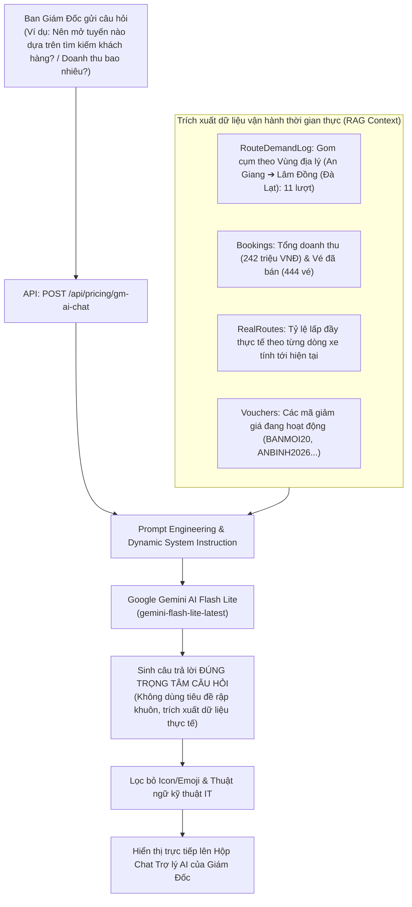

# TÀI LIỆU KỸ THUẬT: HỆ THỐNG PHÂN TÍCH NHU CẦU VẬN TẢI & TRỢ LÝ CỐ VẤN AI (EXECUTIVE AI COPILOT)
**Hệ thống Quản lý và Điều hành Nhà xe An Bình Lines**  
*Tài liệu phục vụ Nghiên cứu, Báo cáo Khóa luận Tốt nghiệp & Vận hành Hệ thống*

---

## 1. TỔNG QUAN CHỨC NĂNG

Trong quản trị vận tải hành khách liên tỉnh, việc ra quyết định điều phối xe, mở tuyến mới hay điều chỉnh giá vé thường phụ thuộc vào trực giác của người quản lý, dễ dẫn đến các rủi ro:
1. **Mở tuyến mới mù quáng:** Đầu tư phương tiện vào các chặng đường không có nhu cầu thực tế, gây thua lỗ chi phí cố định (bến bãi, xăng dầu, lương tài xế).
2. **Không phát hiện kịp thời nhu cầu bị bỏ lỡ:** Khách hàng tìm kiếm vé trên Web/App nhưng nhà xe chưa có tuyến hoặc hết chuyến, doanh nghiệp bỏ qua cơ hội gia tăng thị phần.
3. **Phân bổ phương tiện mất cân đối:** Tuyến đông khách thì thiếu xe (cháy vé), tuyến vắng khách lại chạy xe lớn (lãng phí tải trọng và nhiên liệu).

Chức năng **Phân tích nhu cầu & Trợ lý Cố vấn AI (Demand Analytics & AI Copilot)** của An Bình Lines được xây dựng để giải quyết triệt để các vấn đề trên thông qua:
- **Big Data Analytics & Regional Clustering:** Khảo sát toàn diện dữ liệu đặt vé, lịch trình và lịch sử tìm kiếm chưa được đáp ứng, tự động gom cụm địa lý theo tỉnh thành và khu vực lân cận.
- **Trợ lý Cố vấn AI (Executive AI Copilot):** Tích hợp mô hình ngôn ngữ lớn **Google Gemini AI Flash Lite** đóng vai trò là "Cố vấn trưởng" hỗ trợ Giám Đốc giải đáp mọi câu hỏi điều hành dựa trên dữ liệu thực tế hệ thống (doanh thu, số lượng vé đã bán, tỷ lệ lấp đầy từng tuyến, nhu cầu mở tuyến mới, voucher khuyến mãi).

- **Vị trí chức năng:** Menu *"Xem phân tích nhu cầu"* (Dành riêng cho Ban Giám Đốc).
- **Mã nguồn Frontend:** [frontend/admin-dashboard/src/pages/gm/GmAnalysisPage.js](file:///c:/Users/VanLoc/OneDrive%20-%20Industrial%20University%20of%20HoChiMinh%20City/Documents/KLTN/HeThongQuanLyNhaXe/frontend/admin-dashboard/src/pages/gm/GmAnalysisPage.js)
- **Mã nguồn Backend:**
  - Gemini AI Service (Phân tích ngữ nghĩa địa lý & Cố vấn cấp cao): [backend/services/geminiService.js](file:///c:/Users/VanLoc/OneDrive%20-%20Industrial%20University%20of%20HoChiMinh%20City/Documents/KLTN/HeThongQuanLyNhaXe/backend/services/geminiService.js) (hàm `matchSearchWithNetwork`, `generateUnmetDemandAiAnalysis`, `getExecutiveAiChatResponse`)
  - Controller phân tích: [backend/controllers/pricingController.js](file:///c:/Users/VanLoc/OneDrive%20-%20Industrial%20University%20of%20HoChiMinh%20City/Documents/KLTN/HeThongQuanLyNhaXe/backend/controllers/pricingController.js) (các hàm `getDemandAnalytics`, `getUnmetDemandAnalytics`, `getExecutiveAiChat`)
  - Controller tìm kiếm chuyến xe: [backend/controllers/tripController.js](file:///c:/Users/VanLoc/OneDrive%20-%20Industrial%20University%20of%20HoChiMinh%20City/Documents/KLTN/HeThongQuanLyNhaXe/backend/controllers/tripController.js) (cơ chế tìm kiếm 2 tầng Dynamic 2-Tier AI Matching)
  - Trip Service: [backend/services/tripService.js](file:///c:/Users/VanLoc/OneDrive%20-%20Industrial%20University%20of%20HoChiMinh%20City/Documents/KLTN/HeThongQuanLyNhaXe/backend/services/tripService.js)
  - Model lưu vết nhu cầu: [backend/models/RouteDemandLog.js](file:///c:/Users/VanLoc/OneDrive%20-%20Industrial%20University%20of%20HoChiMinh%20City/Documents/KLTN/HeThongQuanLyNhaXe/backend/models/RouteDemandLog.js)

---

## 2. BA THUẬT TOÁN CỐT LÕI TRONG CHỨC NĂNG

---

### 2.1. THUẬT TOÁN 1: CẢM BIẾN & GOM CỤM ĐỊA LÝ KHÔNG DÙNG TỪ ĐIỂN CỐ ĐỊNH (ZERO-HARDCODE AI DEMAND SENSING & CLUSTERING)

#### A. Triết lý Zero-Hardcode (Không cài cứng danh mục địa danh)
Trước đây, hệ thống sử dụng mảng tĩnh `GEO_REGIONS` để đối chiếu tên huyện, thị xã về tỉnh. Cách làm này mang tính chất "công nghiệp, thủ công", phát sinh các nhược điểm:
1. Thiếu tính linh hoạt khi khách hàng nhập các địa danh mới, điểm du lịch đặc thù (Hồ Tuyền Lâm, KDL Đại Nam...).
2. Phải bảo trì thủ công hàng trăm địa danh trong mã nguồn.

Hệ thống đã loại bỏ hoàn toàn file từ điển tĩnh và thay thế 100% bằng **Mô hình Trí tuệ Nhân tạo Google Gemini Flash Lite (`matchSearchWithNetwork`)**:
- Trích xuất động mạng lưới tuyến đang chạy trực tiếp từ CSDL MongoDB (`Route` và `Trip`).
- Gemini AI tự động suy luận quan hệ địa lý giữa từ khóa khách hàng tìm kiếm và mạng lưới nhà xe.

#### B. Cơ chế Tìm kiếm 2 Tầng Thông minh (Dynamic 2-Tier Search):
1. **Tầng 1 (Direct DB Search):** Truy vấn trực tiếp MongoDB theo tên điểm đi/đến, tên trạm hoặc địa chỉ đón/trả.
2. **Tầng 2 (AI Semantic Network Matcher):** Nếu Tầng 1 trả về 0 kết quả:
   - Hệ thống chuyển câu truy vấn kèm mạng lưới tuyến động sang Gemini AI:
     * *Ví dụ khách tìm:* `"TP. Hồ Chí Minh"` ➔ `"Lâm Đồng"`.
     * *Gemini nhận biết:* Đà Lạt thuộc tỉnh Lâm Đồng, nhà xe có tuyến `"Hồ Chí Minh ➔ Đà Lạt"`.
     * *Kết quả:* `isCovered: true, suggestedTo: 'Đà Lạt'`.
   - Hệ thống tự động truy vấn các chuyến xe đi Đà Lạt và trả về cho khách kèm thẻ `aiSemanticInfo` giải thích rõ lý do.
   - Bản ghi tìm kiếm được gắn cờ `isRouteExistingInSystem: true` và `hasResults: true`, tuyệt đối **không bị đưa vào danh sách nhu cầu mở tuyến mới**.

#### C. Phân biệt Nhu cầu 2 Chiều (full_route) và Nhu cầu 1 Chiều (destination_only / origin_only)
Trong bảng `RouteDemandLog`:
- **Nhu cầu 2 chiều (`full_route`):** Khách chọn cả điểm đi và điểm đến. Gemini tự động gom cụm thành một hành lang chuẩn hóa (VD: gom `"an giang ➔ đà lạt"` và `"An Giang ➔ Lâm Đồng"` thành `"An Giang ➔ Lâm Đồng (Đà Lạt)"` với tổng số 13 lượt tìm kiếm).
- **Nhu cầu 1 chiều (`destination_only` hoặc `origin_only`):** Khách chỉ chọn điểm đến (hoặc điểm đi) và để trống hoặc chọn "Tất cả" ở đầu còn lại. Hệ thống tách riêng vào danh sách `singleDestinations` (Điểm đến 1 chiều được quan tâm) để Ban Giám đốc quan sát độc lập, không làm nhiễu dữ liệu các tuyến 2 chiều.

#### D. Quy tắc phân loại mức độ cấp thiết (Urgency Classification):
1. **URGENT (Nhu cầu Rất Cao - Màu đỏ `#dc2626`):**
   - Điều kiện: $\text{searchCount} \ge 100$ lượt/tháng VÀ cự ly khả thi ($< 600$ km).
   - Ý nghĩa: Đạt ngưỡng hòa vốn thương mại. Đề xuất Giám Đốc mở tuyến chạy thử nghiệm vào dịp cuối tuần.
2. **POTENTIAL (Tiềm năng - Màu cam `#d97706`):**
   - Điều kiện: $30 \le \text{searchCount} < 100$ lượt/tháng.
   - Ý nghĩa: Tín hiệu thị trường rõ nét. Đề xuất khảo sát liên kết trung chuyển với nhà xe đối tác địa phương.
3. **MONITORING (Mới phát hiện - Màu xám `#64748b`):**
   - Điều kiện: $\text{searchCount} < 30$ lượt/tháng HOẶC cự ly quá xa ($> 800$ km).
   - Ý nghĩa: Nhu cầu sơ khởi hoặc cự ly không khả thi chạy xe khách thông thường. Tiếp tục lưu vết theo dõi, chưa đầu tư phương tiện.

---

### 2.2. THUẬT TOÁN 2: PHÂN TÍCH HIỆU SUẤT LẤP ĐẦY THEO TUYẾN XE & ĐỀ XUẤT HÀNH ĐỘNG

#### A. Cơ sở dữ liệu và Mốc thời gian
- **Nguyên tắc thời gian thực:** CHỈ phân tích các chuyến xe thực tế **có thời điểm xuất bến tính đến thời điểm hiện tại ($\text{departureTime} \le now$)**.
- Việc này loại trừ hoàn toàn các chuyến xe trong tương lai xa (được lập lịch tới năm 2027) để tránh pha loãng mẫu số, bảo đảm phản ánh trung thực tỷ lệ lấp đầy ghế.

#### B. Công thức tính Tỷ lệ lấp đầy ghế thực tế ($LF$ - Load Factor):

$$LF = \frac{\sum_{k=1}^{M_{now}} \text{Số ghế đã đặt thành công (Paid/Confirmed)} \text{ của chuyến } k}{\sum_{k=1}^{M_{now}} \text{Sức chứa (Capacity)} \text{ của chuyến } k} \times 100\%$$

#### C. Quy tắc sinh Đề xuất Hành động AI trong Bảng phân tích:
Cột *"ĐỀ XUẤT HÀNH ĐỘNG AI"* trong bảng được tính toán theo quy tắc thuật toán chuẩn hóa:
- **Tuyến Cao Điểm ($LF \ge 80\%$ - Trạng thái: `high`):**
  - Huy hiệu: `Mở thêm chuyến cao điểm` (Màu xanh lá `#16a34a`).
  - Đề xuất: Tăng cường thêm 1-2 chuyến vào khung giờ vàng (19:00 - 22:30), áp dụng phụ thu cao điểm $+10\%$ tối ưu doanh thu.
- **Tuyến Thấp Điểm / Báo Động ($LF \le 45\%$ - Trạng thái: `low`):**
  - Huy hiệu: `Kích cầu vé - BÁO ĐỘNG` (Màu đỏ `#dc2626`).
  - Đề xuất:
    + Phát hành mã giảm giá kích cầu giờ chót (giảm 10% - 20%).
    + Cân nhắc đổi sang xe nhỏ hơn (ví dụ chuyển từ xe 45 chỗ sang xe 16 chỗ/29 chỗ) để tiết kiệm chi phí nhiên liệu.
    + Dồn khách giữa các chuyến liền kề để đạt tải trọng tối thiểu.
- **Tuyến Ổn Định ($46\% \le LF < 80\%$ - Trạng thái: `normal`):**
  - Huy hiệu: `Duy trì tần suất ổn định` (Màu xanh dương `#2563eb`).
  - Đề xuất: Giữ nguyên biểu cước và lịch chạy xe cố định.

---

### 2.3. THUẬT TOÁN 3: TRỢ LÝ CỐ VẤN ĐIỀU HÀNH AI (EXECUTIVE AI COPILOT) - HỎI ĐÁP LINH HOẠT THEO DỮ LIỆU THỰC TẾ

#### A. Kiến trúc kỹ thuật RAG (Retrieval-Augmented Generation)
Trợ lý AI được kết nối trực tiếp với CSDL vận tải thời gian thực (Real-time Context Injection):

#### B. Nguyên tắc trả lời thông minh, không rập khuôn của Chatbot AI:
1. **Trả lời đúng và trúng vào câu hỏi của Giám Đốc:**
   - **Hỏi về mở tuyến mới:** Cung cấp ngay chặng gom cụm có số lượt tìm kiếm cao nhất (**An Giang ➔ Lâm Đồng (Đà Lạt): 11 lượt tìm**), đánh giá tiềm năng liên vùng Tây Nam Bộ - Tây Nguyên và đề xuất số chuyến chạy thử nghiệm, dòng xe phù hợp (xe Giường nằm 44 chỗ).
   - **Hỏi về doanh thu / tài chính:** Báo cáo chính xác tổng số đơn vé thanh toán thành công (444 vé) và tổng doanh thu tích lũy (hơn 242 triệu VNĐ).
   - **Hỏi về tỷ lệ lấp đầy:** Liệt kê chi tiết tỷ lệ lấp đầy của từng tuyến và đề xuất phương án điều xe hoặc kích cầu vé.
   - **Hỏi về giữ lịch xe cố định hay linh hoạt:** Phân tích dựa trên số liệu lấp đầy thực tế để tư vấn giải pháp tiết kiệm chi phí dầu máy.
2. **Cấu trúc linh hoạt, tự nhiên:**
   - Tuyệt đối KHÔNG ép buộc rập khuôn 3 tiêu đề cứng nhắc ("TỔNG QUAN / LƯU Ý / ĐỀ XUẤT") cho mọi câu hỏi.
   - Trình bày mạch lạc, luận điểm rõ ràng, trích dẫn số liệu chứng minh và đưa ra lời khuyên thực tế của một cố vấn chiến lược.
3. **Quy tắc bảo mật & phong thái:**
   - Tuyệt đối không dùng icon/emoji.
   - Tuyệt đối không dùng thuật ngữ kỹ thuật IT (MongoDB, API, collection, JSON).
   - Xưng hô tôn trọng, đúng phong thái tham mưu: *"Dạ thưa Giám đốc..."*.

---

## 3. CÁC ĐIỀU CHỈNH ĐÃ THỰC HIỆN THEO YÊU CẦU CỦA BAN GIÁM ĐỐC

1. **Xóa bỏ hoàn toàn từ điển tĩnh hardcode (`geoCluster.js` đã xóa):**
   - Thay thế toàn bộ bằng mô hình ngôn ngữ lớn **Google Gemini AI Flash Lite** kết nối trực tiếp mạng lưới tuyến CSDL MongoDB.
   - AI tự động suy luận: Đà Lạt, Bảo Lộc, Di Linh, Đức Trọng $\in$ Lâm Đồng; Châu Đốc, Long Xuyên $\in$ An Giang; Cai Lậy, Cái Bè $\in$ Tiền Giang mà không cần bảo trì file mảng tĩnh.
2. **Gom cụm động Nhu cầu mở tuyến (AI Dynamic Regional Clustering):**
   - Tự động hợp nhất các lượt tìm kiếm tương đồng (như *"an giang ➔ đà lạt"* và *"An Giang ➔ Lâm Đồng"*) thành một hành lang duy nhất: **"An Giang ➔ Lâm Đồng (Đà Lạt): 13 lượt"**.
3. **Phân biệt rành mạch Nhu cầu 2 chiều (`full_route`) và Nhu cầu 1 chiều (`singleDestinations`):**
   - Khách tìm 1 chiều (chỉ chọn điểm đến hoặc chỉ chọn điểm đi) được tách riêng thành khu vực "Điểm đến 1 chiều được quan tâm nhiều nhất", không làm sai lệch hành lang tuyến 2 chiều.
4. **Tự động nhận diện mạng lưới phục vụ sẵn có:**
   - Khách tìm *"TP. Hồ Chí Minh ➔ Lâm Đồng"* được hệ thống tìm kiếm tự động trả về 2 chuyến xe đi Đà Lạt (Lâm Đồng) kèm thẻ `aiSemanticInfo` giải thích rõ cho khách hàng.
   - Bản ghi tìm kiếm được gắn cờ `isRouteExistingInSystem: true` và loại trừ hoàn toàn khỏi danh sách nhu cầu mở tuyến mới.
5. **Xóa bỏ khối *"Phân bổ nhu cầu theo Khung giờ Vàng"***:
   - Đã loại bỏ hoàn toàn 4 thẻ (Khung sáng, Khung trưa, Khung tối, Khung đêm) trong giao diện [GmAnalysisPage.js](file:///c:/Users/VanLoc/OneDrive%20-%20Industrial%20University%20of%20HoChiMinh%20City/Documents/KLTN/HeThongQuanLyNhaXe/frontend/admin-dashboard/src/pages/gm/GmAnalysisPage.js) để trang giao diện gọn gàng, tập trung tối đa vào danh sách tuyến và bảng điều khiển của Trợ lý AI.
6. **Nâng cấp Chatbot AI trả lời linh hoạt theo dữ liệu thực tế:**
   - Đã thay thế chỉ thị rập khuôn cũ bằng hệ thống chỉ thị linh hoạt thông minh trong [geminiService.js](file:///c:/Users/VanLoc/OneDrive%20-%20Industrial%20University%20of%20HoChiMinh%20City/Documents/KLTN/HeThongQuanLyNhaXe/backend/services/geminiService.js).
   - Chatbot AI hiện tại phân tích trực tiếp câu hỏi người dùng, trích xuất số liệu thực tế (doanh thu, vé đã bán, lượt tìm An Giang - Đà Lạt 13 lượt, tỷ lệ lấp đầy thực tế) để trả lời trúng đích, sắc sảo.

---

## 4. Ý NGHĨA KHOA HỌC & ĐIỂM SÁNG CHO KHÓA LUẬN

1. **Ứng dụng Trí tuệ Nhân tạo tạo sinh (Generative AI) vào thực tiễn quản trị:** Không dừng lại ở các biểu đồ tĩnh, hệ thống đã ứng dụng Google Gemini AI để "nói chuyện với dữ liệu" (Chat with Big Data), biến các con số khô khan thành khuyến nghị hành động cụ thể cho lãnh đạo doanh nghiệp.
2. **Mô hình Khảo sát nhu cầu tự động & Gom cụm địa lý (Demand Sensing & Spatial Clustering):** Thay vì tốn hàng trăm triệu đồng phát tờ rơi hay thuê công ty khảo sát thị trường, hệ thống tận dụng chính các lượt tìm kiếm không có kết quả của người dùng kết hợp thuật toán gom cụm không gian để phát hiện thị trường tiềm năng chưa ai khai thác.
3. **Tối ưu hóa chi phí vận hành (Operational Cost Efficiency):** Thuật toán cảnh báo sớm tỷ lệ lấp đầy thấp giúp doanh nghiệp linh hoạt đổi dòng xe hoặc phát hành voucher giờ chót, giảm thiểu tối đa tình trạng "xe chạy rỗng" gây lãng phí nhiên liệu.
