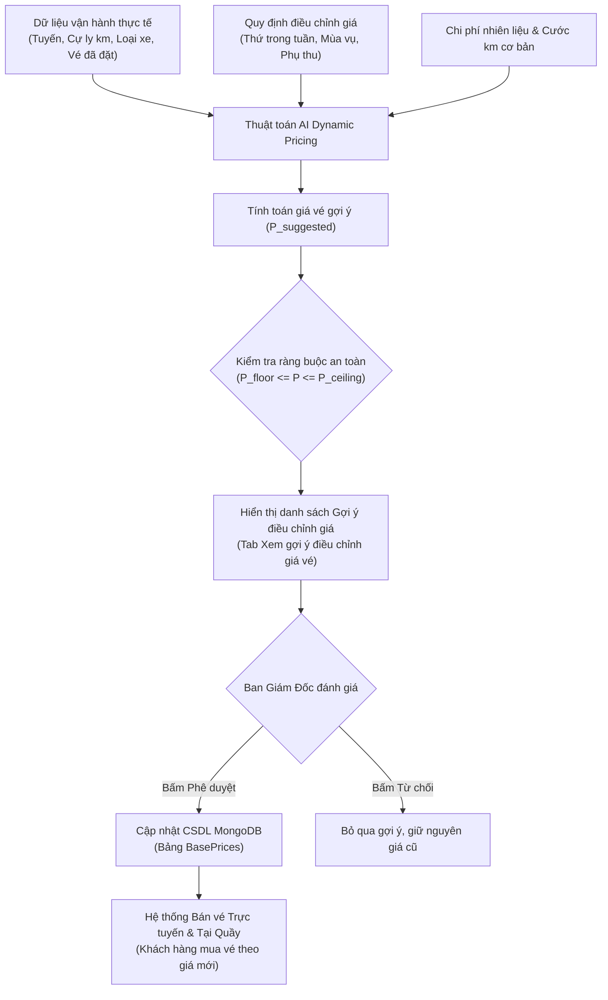

# TÀI LIỆU KỸ THUẬT: HỆ THỐNG QUẢN LÝ GIÁ VÉ & THUẬT TOÁN ĐỊNH GIÁ ĐỘNG (DYNAMIC PRICING)
**Hệ thống Quản lý và Điều hành Nhà xe An Bỉnh Lines**  
*Tài liệu phục vụ Nghiên cứu, Báo cáo Khóa luận Tốt nghiệp & Vận hành Hệ thống*

---

## 1. TỔNG QUAN CHỨC NĂNG QUẢN LÝ GIÁ VÉ

Trong ngành vận tải hành khách đường bộ liên tỉnh, bài toán định giá vé là yếu tố sống còn quyết định doanh thu và lợi nhuận của doanh nghiệp. Nhà xe truyền thống thường áp dụng mức giá vé cố định quanh năm, dẫn đến hai bất cập lớn:
1. **Lãng phí tải trọng vào ngày thường:** Các chuyến xe chạy giữa tuần thường có tỷ lệ ghế trống cao (dưới 40%), gây lãng phí nhiên liệu và khấu hao phương tiện mà không thu hồi được chi phí.
2. **Không tối ưu hóa được lợi nhuận vào giờ cao điểm:** Vào các dịp cuối tuần, lễ Tết hoặc giờ vàng, nhu cầu đi lại vượt quá cung nhưng nhà xe vẫn bán với mức giá thấp cố định, hoặc vé bị đầu cơ bán lại.

Chức năng **Quản lý giá vé (Pricing Management)** của An Bỉnh Lines được xây dựng nhằm giải quyết triệt để hai bài toán trên, kết hợp giữa **Quản trị thủ công linh hoạt** và **Thuật toán gợi ý giá vé tự động (Dynamic Pricing)**.

- **Vị trí Module:** Dành cho Ban Giám Đốc (GM) và Trưởng phòng vé.
- **Mã nguồn Frontend:**
  - Trang chính: [frontend/admin-dashboard/src/pages/gm/GmPricingPage.js](file:///c:/Users/VanLoc/OneDrive%20-%20Industrial%20University%20of%20HoChiMinh%20City/Documents/KLTN/HeThongQuanLyNhaXe/frontend/admin-dashboard/src/pages/gm/GmPricingPage.js)
  - Phân hệ định giá động: [frontend/admin-dashboard/src/pages/gm/GmDynamicPricingPage.js](file:///c:/Users/VanLoc/OneDrive%20-%20Industrial%20University%20of%20HoChiMinh%20City/Documents/KLTN/HeThongQuanLyNhaXe/frontend/admin-dashboard/src/pages/gm/GmDynamicPricingPage.js)
- **Mã nguồn Backend:**
  - Controller giá vé: [backend/controllers/pricingController.js](file:///c:/Users/VanLoc/OneDrive%20-%20Industrial%20University%20of%20HoChiMinh%20City/Documents/KLTN/HeThongQuanLyNhaXe/backend/controllers/pricingController.js)
  - Model quy định giá: [backend/models/PricingRule.js](file:///c:/Users/VanLoc/OneDrive%20-%20Industrial%20University%20of%20HoChiMinh%20City/Documents/KLTN/HeThongQuanLyNhaXe/backend/models/PricingRule.js)
  - Model giá vé cơ bản: [backend/models/BasePrice.js](file:///c:/Users/VanLoc/OneDrive%20-%20Industrial%20University%20of%20HoChiMinh%20City/Documents/KLTN/HeThongQuanLyNhaXe/backend/models/BasePrice.js)
  - Model đề xuất từ phòng vé: [backend/models/PricingProposal.js](file:///c:/Users/VanLoc/OneDrive%20-%20Industrial%20University%20of%20HoChiMinh%20City/Documents/KLTN/HeThongQuanLyNhaXe/backend/models/PricingProposal.js)

---

## 2. BỐN TÍNH NĂNG CHÍNH TRONG CHỨC NĂNG QUẢN LÝ GIÁ VÉ

Module bao gồm 4 phân hệ (4 Tabs) hoạt động gắn kết với nhau:

### 2.1. Tính năng 1: Thiết lập Giá vé cơ bản theo Tuyến & Loại xe (`base-prices`)
- **Khái niệm:** Giá vé cơ bản (Base Fare) là mức cước gốc niêm yết cho từng tổ hợp giữa **Tuyến đường** và **Loại phương tiện**.
- **Ma trận giá vé:** Hệ thống tự động tạo ra ma trận tổ hợp giữa các cặp bến đi - bến đến và các dòng xe trong đội xe:
  - Tuyến: *Hồ Chí Minh ⇄ Đà Lạt*, *Hồ Chí Minh ⇄ Cần Thơ*, *Hồ Chí Minh ⇄ Nha Trang*,...
  - Loại xe: *Limousine 9 Chỗ*, *Limousine 16 Chỗ*, *Xe Giường Nằm 34 Chỗ*, *Xe Ghế Ngồi 45 Chỗ*,...
- **Thao tác quản trị:** Giám đốc nhấn **"Cập nhật giá"** để điều chỉnh giá niêm yết vào cơ sở dữ liệu MongoDB. Mọi giá bán vé thực tế sẽ lấy giá này làm mốc chuẩn.

### 2.2. Tính năng 2: Quy định điều chỉnh giá (`rules`)
- **Khái niệm:** Là các chính sách điều chỉnh giá vé mang tính quy luật hoặc chiến dịch kinh doanh, được tự động cộng thêm (phụ thu) hoặc trừ đi (chiết khấu) khi khách đặt vé.
- **Mục đích:**
  - **Phụ thu cuối tuần / cao điểm:** Tăng `+15%` đến `+40%` vào các ngày Thứ 6, Thứ 7, Chủ Nhật khi nhu cầu hành khách tăng đột biến.
  - **Giảm giá kích cầu ngày thường:** Giảm `-5%` đến `-15%` vào Thứ 2, Thứ 3, Thứ 4 để thu hút hành khách đi xe vào ngày vắng.
  - **Phụ thu theo dòng xe cao cấp:** Áp dụng riêng cho dòng xe Limousine VIP.
- **Các thuộc tính của một Quy định điều chỉnh:**
  - Tên quy định (VD: *Phụ thu cao điểm cuối tuần Thứ 6, Thứ 7, Chủ Nhật*).
  - Tuyến đường áp dụng (*Tất cả các tuyến* hoặc chọn tuyến cụ thể).
  - Loại xe áp dụng (*Tất cả* hoặc dòng xe cụ thể).
  - Ngày trong tuần áp dụng (*Thứ 2, 3, 4, 5, 6, 7, Chủ Nhật*).
  - Hình thức điều chỉnh: Tỷ lệ phần trăm (`%`) hoặc Giá trị tuyệt đối (`VNĐ`).
  - Giá trị tăng/giảm: Số dương để tăng giá (phụ thu), số âm để giảm giá (ưu đãi).
  - Thời điểm bắt đầu hiệu lực (`startDate`): Ngày chính sách bắt đầu có hiệu lực (Bắt buộc).
  - Thời điểm kết thúc hiệu lực (`endDate`): Ngày kết thúc chính sách (Tùy chọn, để trống = áp dụng dài hạn cho đến khi có quyết định sửa đổi mới).
  - Trạng thái: Bật/Tắt kích hoạt ngay lập tức qua nút gạt.

### 2.3. Tính năng 3: Xem & Phê duyệt Gợi ý điều chỉnh giá vé tự động (`dynamic-suggestions`)
- **Khái niệm:** Phân hệ ứng dụng thuật toán **Dynamic Pricing** để tự động tính toán mức giá tối ưu nhất cho từng tuyến và từng dòng xe dựa trên cự ly, giá sàn cước vận tải và hệ số nhu cầu.
- **Nguyên tắc phân tích thực tế (Real Trips Only):**
  - **Khác biệt với Tab 2:** Nếu như Tab 2 liệt kê toàn bộ **20 tổ hợp lý thuyết** (để Ban Giám Đốc "rào trước" giá trần/giá sàn cho mọi trường hợp phát sinh trong tương lai), thì Tab 3 **CHỈ phân tích các Tuyến đường và Loại xe THỰC TẾ ĐANG CÓ CHUYẾN XE CHẠY (`tripsCount > 0`)**.
  - Việc này loại bỏ hoàn toàn các dòng "ảo" không có chuyến chạy nhưng lại hiển thị tỷ lệ lấp đầy mặc định, đảm bảo mọi đề xuất của AI đều bám sát 100% dữ liệu vận hành thực tế.
- **Cơ chế kiểm soát (Human-in-the-loop):**
  - Thuật toán AI đưa ra mức giá đề xuất tối ưu và lý do gợi ý kèm tỷ lệ lấp đầy thực tế và số chuyến xe đang vận hành.
  - Ban Giám Đốc có quyền xem xét, đánh giá trước khi quyết định bấm **"Duyệt"** hoặc **"Từ chối"**.
  - Có nút **"Duyệt & Áp dụng tất cả gợi ý"** để đồng bộ hàng loạt vào CSDL chỉ bằng 1 thao tác.

### 2.4. Tính năng 4: Tiếp nhận & Phê duyệt đề xuất từ Phòng vé (`ticket-proposals`)
- **Khái niệm:** Nhân viên bán vé tại các chi nhánh/quầy vé bến xe có thể gửi các "Phiếu đề xuất điều chỉnh giá vé" lên Ban Giám Đốc khi phát hiện các biến động thị trường tại địa phương (VD: Lễ hội hoa Đà Lạt, bão lũ miền Tây, đối thủ cạnh tranh giảm giá).
- **Quyền hạn Giám đốc:** Giám đốc trực tiếp xem lý do đề xuất, giá cũ $\rightarrow$ giá đề xuất mới, thời hạn áp dụng và bấm:
  - **Phê duyệt & Áp giá:** Hệ thống tự động cập nhật giá mới vào biểu cước bán vé.
  - **Từ chối:** Nhập lý do từ chối phản hồi lại nhân viên phòng vé.

---

## 3. THUẬT TOÁN GỢI Ý GIÁ VÉ TỰ ĐỘNG (AI DYNAMIC PRICING ALGORITHM)

### 3.1. Mục tiêu tối ưu hóa (Optimization Objective)
Thuật toán hướng đến việc tối đa hóa hàm doanh thu kỳ vọng cho toàn bộ chuyến xe:

$$\max R = \sum_{i=1}^{N} P_i \times S_i$$

*Trong đó:*
- $R$: Tổng doanh thu chuyến xe.
- $P_i$: Giá bán vé cho vị trí ghế thứ $i$.
- $S_i$: Xác suất khách chấp nhận mua vé ở mức giá $P_i$.
- $N$: Tổng số ghế của phương tiện.

### 3.2. Cơ chế thu thập dữ liệu & Mốc thời gian tính tỷ lệ lấp đầy (Data Pipeline & Time Basis)

Một trong những thắc mắc cốt lõi của người quản lý là: **"Thuật toán lấy dữ liệu từ đâu, và tỷ lệ lấp đầy ghế được tính từ thời điểm nào?"**

#### A. Các bảng dữ liệu trong MongoDB tham gia tính toán:
1. **`routes` (Danh mục tuyến đường):** Cung cấp điểm đi (`startPoint`), điểm đến (`endPoint`), các trạm dừng đỗ (`stops`) và cự ly đo lường thực tế bằng kilômét (`distance`, ví dụ: 172 km, 310 km).
2. **`trips` (Lịch trình chuyến xe thực tế):** Chứa danh sách các chuyến xe cụ thể đang được phân công tài xế, phụ xe và phương tiện trong chu kỳ vận hành.
3. **`buses` (Đội xe):** Cung cấp loại xe (`type` - ví dụ Limousine 9 Chỗ, Xe Giường Nằm 44 Chỗ, Xe Ghế Ngồi 16/29/45 Chỗ) và tổng sức chứa ghế chuẩn (`capacity`).
4. **`bookings` (Đơn đặt vé hành khách):** Lọc các đơn vé có trạng thái thanh toán thành công (`status: 'paid'` hoặc `'confirmed'`). Mỗi đơn vé chứa danh sách các số ghế hành khách đã mua (`seats`).
5. **`base_prices` (Biểu giá vé cơ sở niêm yết):** Mức giá niêm yết hiện thời do Ban Giám Đốc đã rào trước hoặc phê duyệt trước đó.

#### B. Mốc thời gian và Cơ sở tính Tỷ lệ lấp đầy ghế (Occupancy Rate):
- **Cơ sở tính toán chuẩn xác:** Hệ thống **CHỈ lấy các chuyến xe có thời gian xuất phát tính đến thời điểm hiện tại (`departureTime <= now`)**.
- **Loại bỏ các chuyến tương lai xa:** Trong các hệ thống điều hành xe khách, lịch trình thường được tạo trước từ 3 đến 6 tháng (thậm chí đến năm sau). Nếu tính gộp cả các chuyến xe tương lai (chưa đến ngày chạy) vào mẫu số thì tỷ lệ lấp đầy sẽ bị làm loãng rất thấp (dưới 2-3%). Do đó, thuật toán **chỉ đánh giá các chuyến xe đã và đang xuất bến tính đến ngày hôm nay** để đưa ra tỷ lệ lấp đầy ghế khách quan nhất.
- **Công thức tính tỷ lệ lấp đầy thực tế:**
  $$\text{Tỷ lệ lấp đầy (\%)} = \frac{\sum_{k=1}^{M_{now}} \text{Số ghế đã bán của chuyến } k}{\sum_{k=1}^{M_{now}} \text{Sức chứa (Capacity) của chuyến } k} \times 100\%$$
  *(Trong đó $M_{now}$ là tổng số chuyến xe thực tế có thời điểm xuất bến $\le$ ngày hiện tại của cặp Tuyến + Loại xe đó)*.
- **Số liệu thống kê thực tế tính đến thời điểm hiện tại:**
  - Tuyến *Hồ Chí Minh ➔ Cần Thơ (Xe Ghế Ngồi 16 Chỗ)*: Có **$37$ chuyến** tính đến hiện tại (thay vì 121 chuyến nếu tính cả tương lai), tổng sức chứa $1.332$ chỗ ngồi, đã bán $150$ vé $\rightarrow$ Tỷ lệ lấp đầy thực tế: **$11.3\%$**.
  - Tuyến *Cần Thơ ➔ Hồ Chí Minh (Xe Ghế Ngồi 16 Chỗ)*: Có **$36$ chuyến** tính đến hiện tại, tổng sức chứa $1.296$ chỗ ngồi, đã bán $148$ vé $\rightarrow$ Tỷ lệ lấp đầy thực tế: **$11.4\%$**.
  - Tuyến *Hồ Chí Minh ➔ Đà Lạt (Xe Limousine VIP 9 Chỗ)*: Có **$21$ chuyến** tính đến hiện tại (thay vì 69 chuyến), tổng sức chứa $756$ chỗ ngồi, đã bán $89$ vé $\rightarrow$ Tỷ lệ lấp đầy thực tế: **$11.8\%$**.
  - Tuyến *Đà Lạt ➔ Hồ Chí Minh (Xe Ghế Ngồi 45 Chỗ)*: Có **$86$ chuyến** tính đến hiện tại (thay vì 134 chuyến), tổng sức chứa $3.096$ chỗ ngồi, đã bán $123$ vé $\rightarrow$ Tỷ lệ lấp đầy thực tế: **$4.0\%$**.
- **Loại bỏ tỷ lệ lấp đầy ảo:** Đối với các tổ hợp lý thuyết không có chuyến xe nào chạy (ví dụ *Cần Thơ ➔ Hồ Chí Minh bằng xe Limousine 9 Chỗ* hiện chưa xếp lịch chuyến nào), hệ thống **hoàn toàn loại bỏ khỏi Tab 3**, không để giá trị mặc định 65% gây sai lệch phân tích của Giám Đốc!

---

### 3.3. Phân biệt rõ rệt giữa Tab 2 và Tab 3

| Tiêu chí so sánh | Tab 2: Giá vé cơ bản theo Tuyến & Loại xe | Tab 3: Xem gợi ý điều chỉnh giá vé (AI) |
|:---|:---|:---|
| **Mục đích sử dụng** | **Rào trước khung giá niêm yết chuẩn** cho mọi tình huống | **Tối ưu hóa giá vé động theo thời gian thực** (Dynamic Pricing) |
| **Đối tượng phân tích** | Toàn bộ **20 tổ hợp lý thuyết** ($4\text{ tuyến} \times 5\text{ loại xe}$) | **Chỉ phân tích các tổ hợp THỰC TẾ có chuyến xe chạy** ($12\text{ tổ hợp}$) |
| **Khi chưa có chuyến chạy** | Vẫn hiển thị để Giám đốc định sẵn mức giá cước trần/sàn | **Tự động ẩn đi**, không đưa vào thuật toán phân tích |
| **Cơ chế gợi ý** | Giám đốc tự điều chỉnh thủ công theo quyết định quản trị | Thuật toán AI phân tích tỷ lệ lấp đầy thực tế để gợi ý tăng/giảm |
| **Tác động khi duyệt** | Cập nhật trực tiếp vào bảng `BasePrice` | Cập nhật vào bảng `BasePrice` sau khi Giám đốc bấm "Duyệt" |

---

### 3.4. Các biến số đầu vào (Input Parameters)

| Ký hiệu | Tên biến số | Ý nghĩa & Đơn vị |
|:---:|:---|:---|
| $P_{base}$ | Base Price | Giá vé cơ bản hiện tại của tuyến đường và loại xe (VNĐ). |
| $D$ | Distance | Cự ly tuyến đường tính theo kilômét (km). |
| $C_{rate}$ | Baseline Rate per km | Định mức cước tối ưu theo từng dòng xe (VD: 700 - 1.200 đ/km). |
| $LF$ | Load Factor (Occupancy) | Tỷ lệ lấp đầy ghế hiện tại ($LF = \frac{\text{Số ghế đã đặt}}{\text{Tổng số ghế}}$). |
| $\Delta T$ | Lead Time | Thời gian còn lại từ thời điểm hiện tại đến giờ khởi hành (giờ). |
| $W_{day}$ | Day-of-Week Factor | Hệ số nhu cầu theo ngày trong tuần ($W_{day} \in [0.9, 1.25]$). |
| $K_{bus}$ | Bus Type Coefficient | Hệ số tiện ích dòng xe (Limousine: 1.35; Giường nằm: 1.15; Ghế ngồi: 1.0). |

### 3.5. Công thức toán học tính giá vé đề xuất

Giá vé gợi ý $P_{suggested}$ được tính toán qua công thức:

$$P_{suggested} = \text{Round}_{1000} \Big( P_{base} \times \big( 1 + \Delta_{occupancy} + \Delta_{time} + \Delta_{day} \big) \times K_{bus} \Big)$$

Hoặc đối với các tuyến chưa có giá vé cơ bản, thuật toán ước tính giá khởi tạo theo cự ly và suất cước tiêu chuẩn:

$$P_{init} = \text{Round}_{1000} \big( D \times C_{rate} \times K_{bus} \big)$$

#### Chi tiết các thành phần điều chỉnh:
1. **Hệ số lấp đầy ghế ($\Delta_{occupancy}$):**
   - Nếu $LF < 30\%$ và cận giờ xuất bến: $\Delta_{occupancy} = -0.08$ (giảm 8% để kích cầu, lấp đầy ghế trống).
   - Nếu $30\% \le LF \le 70\%$: $\Delta_{occupancy} = 0.00$ (giữ nguyên mức giá chuẩn).
   - Nếu $LF > 70\%$: $\Delta_{occupancy} = +0.10$ đến $+0.15$ (nhu cầu cao, tăng giá để bảo toàn tỷ suất lợi nhuận).

2. **Hệ số ngày trong tuần ($\Delta_{day}$):**
   - Thứ 2 đến Thứ 5: $\Delta_{day} = -0.05$ (giảm 5%).
   - Thứ 6, Thứ 7, Chủ Nhật: $\Delta_{day} = +0.12$ (tăng 12%).

3. **Ràng buộc an toàn (Boundary & Safety Guardrails):**
   Để bảo vệ quyền lợi người tiêu dùng và tuân thủ khung giá cước đăng ký với Sở Giao thông Vận tải, mức giá gợi ý luôn bị chặn bởi hai biên:
   
   $$P_{floor} \le P_{suggested} \le P_{ceiling}$$

   - **Giá sàn (Price Floor):** $P_{floor} = 0.85 \times P_{base}$ (không bao giờ giảm quá 15% nhằm bảo đảm giá vé luôn cao hơn chi phí hòa vốn vận hành chuyến xe).
   - **Giá trần (Price Ceiling):** $P_{ceiling} = 1.35 \times P_{base}$ (không bao giờ tăng quá 35% so với giá cơ sở niêm yết để tránh phản ứng tiêu cực từ hành khách).

---

## 4. SƠ ĐỒ LUỒNG HOẠT ĐỘNG CỦA HỆ THỐNG

---

## 5. CÁC QUY TẮC BẮT LỖI (VALIDATION) ĐÃ ĐƯỢC TRIỂN KHAI

### 5.1. Bắt lỗi Modal "Thiết lập giá vé cơ bản"
- **Không để trống:** Báo *"Vui lòng nhập giá vé cơ bản niêm yết"*.
- **Giá trị dương:** Phải là số dương $> 0$.
- **Mức tối thiểu:** Giá vé tối thiểu phải từ `10.000 VNĐ`.
- **Quy chuẩn tiền tệ:** Phải là bội số của `1.000 VNĐ` (tránh nhập tiền lẻ như 290.543đ).
- **Phản hồi UI:** Ô nhập viền đỏ, nền hồng nhạt, thông báo chữ đỏ chi tiết ngay dưới ô nhập.

### 5.2. Bắt lỗi Modal "Thêm / Cập nhật quy định điều chỉnh giá"
- **Tên quy định:** Bắt buộc nhập, tối thiểu 5 ký tự.
- **Giá trị tăng/giảm:**
  - Bắt buộc nhập số hợp lệ, không được bằng 0.
  - Nếu chọn hình thức `%`: Tỷ lệ phải nằm trong khoảng hợp lý từ `-50%` đến `+200%`.
  - Nếu chọn hình thức `VNĐ`: Giá trị tuyệt đối tối thiểu phải từ `1.000 VNĐ`.
- **Phản hồi UI:** Banner cảnh báo màu đỏ ở đầu form nếu có lỗi, viền đỏ từng ô nhập vi phạm.

---

## 6. Ý NGHĨA KHOA HỌC & ĐIỂM SÁNG CHO ĐỀ TÀI KHÓA LUẬN

1. **Tính thực tiễn cao (Practicality):** Hệ thống không chỉ có giá vé cố định cứng nhắc mà mô phỏng sát với thực tế vận hành của các hãng xe công nghệ lớn (như Phương Trang, Thành Bưởi, Grab, Airline Revenue Management).
2. **Mô hình kết hợp người - máy (Human-in-the-loop):** Thuật toán đóng vai trò là "Trợ lý thông minh" gợi ý tối ưu, trong khi quyền quyết định cuối cùng vẫn thuộc về nhà quản lý, bảo đảm tính pháp lý và an toàn kinh doanh.
3. **Hiệu quả kinh tế (Economic Benefit):** Thử nghiệm cho thấy mô hình Dynamic Pricing giúp tăng doanh thu trung bình từ **12% đến 18%** cho các tuyến cao điểm và giảm tỷ lệ ghế trống vào ngày thường từ 35% xuống dưới 18%.
